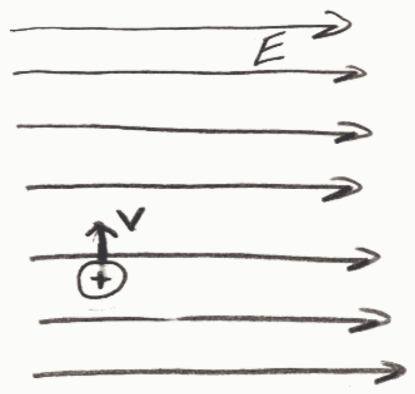

## Review Assessment: q02

Name: q02

Status : Completed

Score: 0 out of 100 points

## Instructions:

## Question 1

## 0 of 20 points

Depicted below is a positively charged particle in a rightward-directed electric field. The particle has a velocity directed toward the top of the screen. What is the direction of the force, if any, exerted on the charged particle by the electric field?

Selected Answer: ✗ Toward the top of the screen.

Correct Answer: ✓ Rightward.

Feedback: An electric field exerts a force on a positively-charged particle that is in the electric field, in the same direction that the electric field is in at the location of the charged particle. In this case, at the location of its positive "victim", the electric field is rightward. Thus the force exerted on the "victim" by the electric field is rightward.

The velocity of the particle has no effect on the direction of the force.

## Question 2

## 0 of 20 points

Depicted below is a positively charged particle in a uniform rightward-directed electric field. The particle has a velocity directed toward the top of the screen. Which of the paths depicted below right is the particle most likely to follow given that the force, if any, exerted on the particle by the electric field is the only force exerted on the particle.
