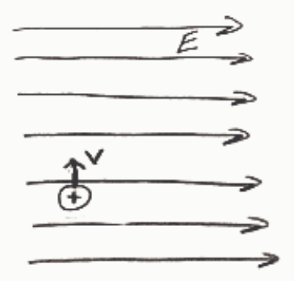
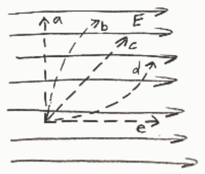

Selected Answer: ✗ Path a

Correct Answer: ✓ Path b

Feedback: The electric field exerts a rightward force on the positively charge particle. The result is a rightward acceleration. The initial velocity is toward the top of the page, at right angles to the acceleration. Because it is at right angles to the acceleration, this component of the velocity never changes. The rightward-directed velocity is initially zero. Because of the rightward acceleration, the rightward component of the velocity grows with time. Moving toward the top of the page at a constant speed while moving rightward at an ever-increasing speed, results in a parabolic trajectory such as that depicted by curve b.

## Question 3

0 of 20 points

Is it possible for an electron to be moving northward in a northward-directed electric field?

Selected Answer: ✗ Only if there is a northward force exerted on the particle by some agent other than the electric field.

Correct Answer: ✓ Yes, even if the force exerted on the electron by the electric field is the only force acting on the particle.

Feedback: The force exerted on a negatively charged particle by an electric field is in the direction opposite to the direction of the electric field at the location of its negatively-charged "victim". So in this case, there is a southward force on the electron. This results in a southward acceleration. If the particle is going northward, and the electric force is the only force acting on it, then the particle must be slowing down. But there is no reason that it can't be moving forward under these circumstances. It doesn't need a force in the northward direction to be moving northward. It's analogous to a rock thrown upward. After it leaves the thrower's hand, the rock is going upward, even though the only force (assuming air resistance to be negligible) acting on it is the gravitational force which is in the downward direction. There may have been a northward force acting on the particle in the past, but that is part of its history. The question is about the electron's "here and now".

## Question 4

0 of 20 points

Which of the following is not true of an electric field?

Selected Answer: ✗ It has direction.

Correct Answer: ✓ It cannot exist in vacuum.

Feedback: An electric field can and does exist in vacuum. Except for the one about vacuum, all the answers are part of the definition of the electric field.

It is an electric field in the vacuum inside a television picture tube which accelerates electrons to the front of the picture tube where they crash into a phosphorescent coating causing the latter to emit the light which we see as television images.

## Question 5

0 of 20 points
