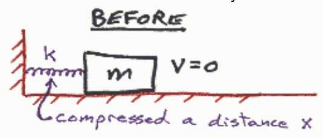
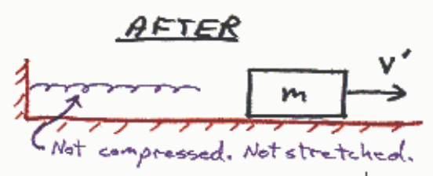

Selected Answer: ✗ 0 mgh

Correct Answer: ✓ ½kx²

Feedback: We start with a spring sticking out of a wall. The spring extends horizontally over a flat, horizontal frictionless surface. Now someone pushes a block up against the end of the spring. The person pushes the block directly toward the wall compressing the spring. Energy is stored in the spring as it is compressed. Then the person releases the block. It is at this instant, the instant that the person is out of the picture, that we can begin applying conservation of energy. At that instant, before the spring has had time to start expanding, the spring is compressed the known amount x and the block is at rest. That is the instant to be characterized by the *Before Picture*.

In the after picture, the block is free of the spring. We can solve for the kinetic energy $K'$ in the after picture by setting the total mechanical energy in the before picture equal to the total mechanical energy in the after picture:

$$E = E'$$

$$K + U = K' + U'$$

$$0 + \frac{1}{2}kx^2 = K' + 0$$

$$K' = \frac{1}{2}kx^2$$

Note how important it is to write a lower case k (spring constant) that is distinguishable from an upper case K (kinetic energy).

## Question 4

## 20 of 20 points

Which has more rotational kinetic energy, an object with a rotational inertia of $4\ \text{kg}\cdot\text{m}^2$ and an angular velocity of $8\ \text{rad/s}$, or, an object with a rotational inertia of $8\ \text{kg}\cdot\text{m}^2$ and an angular velocity of $4\ \text{rad/s}$?

Selected Answer: ✓ An object with a rotational inertia of $4\ \text{kg}\cdot\text{m}^2$ and an angular velocity of $8\ \text{rad/s}$.

Correct Answer: ✓ An object with a rotational inertia of $4\ \text{kg}\cdot\text{m}^2$ and an angular velocity of $8\ \text{rad/s}$.

Feedback: Nice work!

$$I_1 = 4\,\text{kg}\cdot\text{m}^2$$

$$\omega_1 = 8\,\frac{\text{rad}}{\text{s}}$$

$$K_1 = \frac{1}{2}I_1\omega_1^2$$

$$K_1 = \frac{1}{2}(4\,\text{kg}\cdot\text{m}^2)\left(8\,\frac{\text{rad}}{\text{s}}\right)^2$$

$$K_1 = 128\ \text{J}$$

$$I_2 = 8\,\text{kg}\cdot\text{m}^2$$

$$\omega_2 = 4\,\frac{\text{rad}}{\text{s}}$$

$$K_2 = \frac{1}{2}I_2\omega_2^2$$

$$K_2 = \frac{1}{2}(8\,\text{kg}\cdot\text{m}^2)\left(4\,\frac{\text{rad}}{\text{s}}\right)^2$$

$$K_2 = 64\ \text{J}$$

$$\boxed{K_1 > K_2}$$

## Question 5

## 0 of 20 points

A disk lies horizontally on a massless, frictionless, rotational motion support such that the disk is spinning freely about a vertical axis through the center of the disk and perpendicular to the face of the disk. A second disk, identical to the first disk is held in place a negligible height (immeasurably close but not touching) above the first disk. The second disk is aligned so perfectly with the first disk that the axis of rotation of the first disk also passes through the center of the second disk. The person holding the second disk drops it onto the first disk and the two disks spin as
