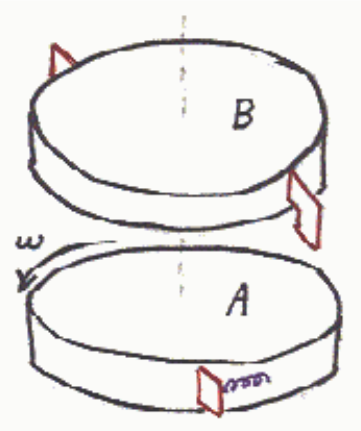

B is dropped (from a negligible height) onto the frictionless surface of A. A continues to rotate a fraction of a turn, as if nothing had happened, until the springs on A run into the tabs on B. The “collision”, gets B spinning ever faster in the same direction of A and slows A down, while compressing the springs, until at one instant, A and B are spinning at the same rate. At that instant, the disks are spinning as one with a single velocity just as in the case of two plain disks with friction. (As time goes by after that, the spring will decompress speeding up B even more and slowing A even more but we focus our attention on that instant when the spring is maximally compressed and the disks have one and the same angular velocity).

The pair-of-disks with the springs and tabs, at that instant, will have the same kinetic energy as the pair-of-disks with friction. In the case of the disks with the springs and tabs, however, there is also potential energy stored in the springs. There is no such additional mechanical energy in the case of the plain disks with friction. As such, that amount of mechanical energy that would be stored in the springs in the idealized case, must have been lost (converted to other forms such as thermal energy and permanent deformation) in the actual case involving two plain disks with friction. Mechanical energy is not conserved whether sliding is apparent or not.
