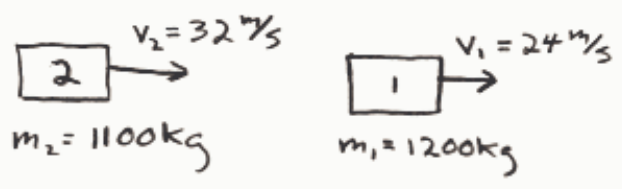
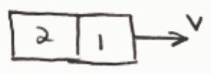

## Review Assessment: Lec 04 Quiz

Name: Lec 04 Quiz

Status : Completed

Score: 0 out of 100 points

Instructions:

## Question 1

## 0 of 20 points

Consider a bowling ball and a Ping Pong ball, each moving along a straight line path at constant velocity. Which has the greater magnitude of momentum?

Selected Answer: ✗ Neither, they both have the same momentum.

Correct Answer: ✓ Insufficient information is given to determine a definite answer.

Feedback: One needs to know the speed of each. Given the objects, the bowling ball clearly has much more mass. But momentum depends on both mass and velocity. Suppose the bowling ball's mass is 1000 times that of the Ping Pong ball. If the speed of the Ping Pong ball is less than 1000 times the speed of the bowling ball, then the magnitude of the bowling ball's momentum is greater. But if the speed of the Ping Pong ball is greater than 1000 times the speed of the bowling ball, then the magnitude of the Ping Pong ball's momentum is greater.

## Question 2

## 0 of 20 points

Consider two cars, both moving eastward along a straight road. Car 1 is in front of car 2. Car 1 has a mass of 1200 kg and a speed of 24 m/s. Car 2 has a mass of 1100 kg and a speed of 32 m/s. Consider eastward to be the positive direction. Car 2 collides with car 1. The two cars stick together and move off as one object. No external eastward/westward forces act on either car. What is the total momentum of the combination object, consisting of the two cars stuck together, after the collision?

Selected Answer: ✗ Zero

Correct Answer: ✓ 64,000 kg·m/s

Feedback:

BEFORE:

$$
\begin{array}{l}
p = p_1 + p_2 \\
\phantom{p} = m_1 v_1 + m_2 V_2 \\
\phantom{p} = 1200\ \text{kg} (24\ \text{m/s}) + 1100\ \text{kg} (32\ \text{m/s})
\end{array}
$$

$$
p = 64,000\ \text{kg} \cdot \text{m/s}
$$

AFTER:

$$
p' = p
$$

$$
\boxed{p' = 64,000\ \text{kg} \cdot \frac{\text{m}}{\text{s}}}
$$

## Question 3

## 0 of 20 points
