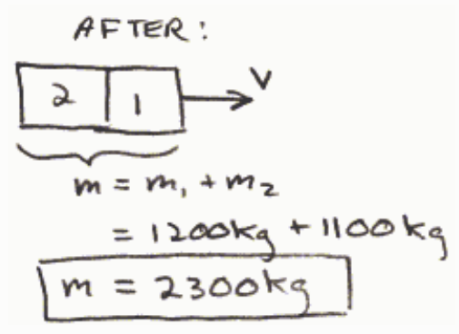
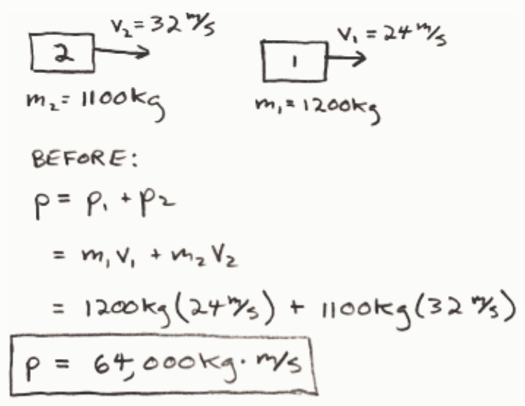

Consider two cars, both moving eastward along a straight road. Car 1 is in front of car 2. Car 1 has a mass of 1200 kg and a speed of 24 m/s. Car 2 has a mass of 1100 kg and a speed of 32 m/s. Consider eastward to be the positive direction. Car 2 collides with car 1. The two cars stick together and move off as one object. No external eastward/westward forces act on either car. What is the mass of the combination object consisting of the two cars stuck together?

Selected Answer: ✗ 100 kg

Correct Answer: ✓ No other answer provided is correct.

Feedback:

$$m = m_1 + m_2$$

$$= 1200\ \text{kg} + 1100\ \text{kg}$$

$$\boxed{m = 2300\ \text{kg}}$$

## Question 4

## 0 of 20 points

Consider two cars, both moving eastward along a straight road. Car 1 is in front of car 2. Car 1 has a mass of 1200 kg and a speed of 24 m/s. Car 2 has a mass of 1100 kg and a speed of 32 m/s. Consider eastward to be the positive direction. Car 2 collides with car 1. The two cars stick together and move off as one object. No external eastward/westward forces act on either car. What is the total momentum of the system of cars prior to the collision?

Selected Answer: ✗ Zero

Correct Answer: ✓ 64,000 kg·m/s

Feedback: The total momentum is the sum of the momentum of car 1 and the momentum of car 2. Calculate each momentum individually and then add them together.

$$p = p_1 + p_2$$

$$= m_1 v_1 + m_2 v_2$$

$$= 1200\ \text{kg}\,(24\ \text{m/s}) + 1100\ \text{kg}\,(32\ \text{m/s})$$

$$\boxed{p = 64,000\ \text{kg} \cdot \text{m/s}}$$

## Question 5

## 0 of 20 points

Consider two cars, both moving eastward along a straight road. Car 1 is in front of car 2. Car 1 has a mass of 1200 kg and a speed of 24 m/s. Car 2 has a mass of 1100 kg and a speed of 32 m/s. Consider eastward to be the positive direction. Car 2 collides with car 1. The two cars stick together and move off as one object. No external eastward/westward forces act on either car. What is the velocity of the combination object, consisting of the two cars stuck together, after the collision?
