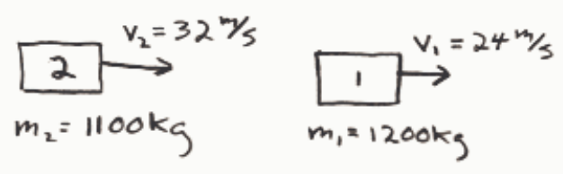
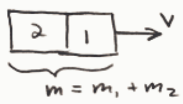

Selected Answer: ✗ Zero

Correct Answer: ✓ 28 m/s

Feedback:

BEFORE:

$$
\begin{array}{l}
p = p_1 + p_2 \\
\phantom{p} = m_1 V_1 + m_2 V_2 \\
\phantom{p} = 1200\ \text{kg} (24\ \text{m/s}) + 1100\ \text{kg} (32\ \text{m/s})
\end{array}
$$

$$
p = 64,000\ \text{kg} \cdot \text{m/s}
$$

AFTER:

$$
m = m_1 + m_2
$$

$$
= 1200\ \text{kg} + 1100\ \text{kg}
$$

$$
\boxed{m = 2300\ \text{kg}}
$$

$$
p' = p
$$

$$
\boxed{p' = 64,000\ \text{kg} \cdot \frac{\text{m}}{\text{s}}}
$$

$$
p' = mV
$$

$$
V = \frac{p'}{m}
$$

$$
V = \frac{64,000\ \text{kg} \frac{\text{m}}{\text{s}}}{2300\ \text{kg}} = 27.8 \frac{\text{m}}{\text{s}}
$$

$$
\boxed{V = 28 \frac{\text{m}}{\text{s}}}
$$
