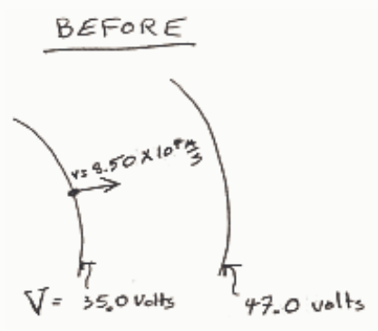
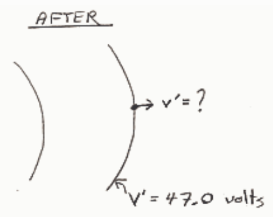

ENERGY BEFORE = ENERGY AFTER

$$E = E'$$

$$K + U = K' + U'$$

$$\frac{1}{2}mv^2 + qV = \frac{1}{2}mv'^2 + qV'$$

$$\frac{1}{2}mv'^2 = \frac{1}{2}mv^2 + q(V - V')$$

$$v' = \sqrt{v^2 + \frac{2q}{m}(V - V')}$$

$$v' = \sqrt{\left(8.50 \times 10^4\ \frac{\text{m}}{\text{s}}\right)^2 + \frac{2(1.60 \times 10^{-19}\ \text{C})}{1.67 \times 10^{-26}\ \text{kg}}(35.0\ \text{volts} - 47.0\ \text{volts})}$$

$$\boxed{v' = 8.36 \times 10^4\ \text{m/s}}$$

UNITS: $\sqrt{\left(\frac{\text{m}}{\text{s}}\right)^2 + \frac{\text{C}}{\text{kg}}\ \text{volt}} = \sqrt{\left(\frac{\text{m}}{\text{s}}\right)^2 + \frac{\cancel{\text{C}}}{\text{kg}}\ \frac{\text{J}}{\cancel{\text{C}}}}$

$$= \sqrt{\left(\frac{\text{m}}{\text{s}}\right)^2 + \frac{1}{\cancel{\text{kg}}}\ \frac{\cancel{\text{kg}} \cdot \text{m}^2}{\text{s}^2}}$$

$$= \sqrt{\left(\frac{\text{m}}{\text{s}}\right)^2}$$

$$= \frac{\text{m}}{\text{s}}$$

## Question 3

## 0 of 15 points

An electron is released from rest at a point in an evacuated region of space at which the electric potential is 5.0 volts. No force other than the force of the electric field characterized by the electric potential under discussion acts on the electron. What is the kinetic energy of the electron when it is at a location where the electric potential is 16 volts?

Selected Answer: ✗ 21 m/s
