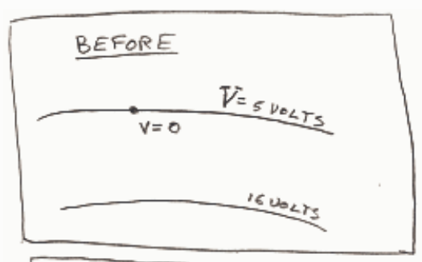
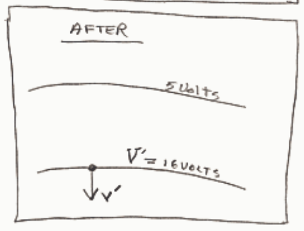

Feedback: The charge of an electron is $-1\text{e}$ and the potential energy of a charged particle in an electric field is the product of the charge of the particle and the value of the electric potential at the location of the particle. The electron starts out at a location where the electric potential is $5\text{V}$ so its initial potential energy is $-1\text{e}$ times $5\text{V}$. That's $-5\text{eV}$. The eV is a non-SI unit of energy. It's easy enough to convert a value in eV to Joules. Just replace the e with $1.6 \times 10^{-19}\text{C}$ and the V with $1\text{J/C}$ (that's what a volt is, a Joule per Coulomb), and simplify. But why bother. The eV might not be an SI unit of energy but it's still a unit of energy. And "$-5$" is easier to write than "$-8 \times 10^{-19}$".

At the point where the electric potential is $16\text{V}$, the potential energy of the electron is $-1\text{e} \times 16\text{V}$ or $-16\text{eV}$. So the electric potential energy of the electron goes from $-5\text{eV}$ to $-16\text{eV}$ representing a decrease in the potential energy of the electron of $11\text{eV}$. By conservation of energy this decrease must be accompanied by a corresponding increase in the kinetic energy of the electron. That is, the electron's kinetic energy increases by $11\text{eV}$. Since it started out with zero kinetic energy (we were told it started at rest) the final kinetic energy of the electron must be $11\text{eV}$. This is worked out for you in mathematical notation below.

$$\text{ENERGY BEFORE} = \text{ENERGY AFTER}$$

$$E = E'$$

$$k^{\circ} + u = k' + u'$$

$$q^{V} = k' + q^{V'}$$

$$k' = qV - qV'$$

$$k' = q(V - V')$$

$$k' = -1\text{e} (5\text{volts} - 16\text{volts})$$

$$k' = 11\text{eV}$$
