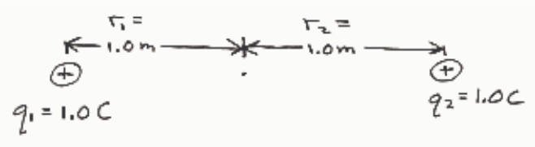

$$V = V_1 + V_2$$

$$= k\frac{q_1}{r_1} + \frac{kq_2}{r_2}$$

$$= 8.99 \times 10^9\,\frac{\text{N}\cdot\text{m}^2}{\text{C}^2}\ \frac{1.0\,\text{C}}{1.0\,\text{m}} + 8.99 \times 10^9\,\frac{\text{N}\cdot\text{m}^2}{\text{C}^2}\ \frac{1.0\,\text{C}}{1.0\,\text{m}}$$

$$= 18 \times 10^9\ \frac{\text{N}\cdot\text{m}}{\text{C}}$$

$$= 18 \times 10^9\ \frac{\text{J}}{\text{C}}$$

$$\boxed{V = 18 \times 10^9\ \text{volts}}$$

## Question 6

## 15 of 15 points

Where is the electric potential due to a single negatively charged particle a maximum?

Selected Answer: ✓ At any location that is an infinite distance from the charged particle.

Correct Answer: ✓ At any location that is an infinite distance from the charged particle.

Feedback: Give yourself a pat on the back!

One could get at this one by looking at the formula for the electric potential due to a point charge $V = -kq/r$. $r$ is the separation between the charged particle and the empty point in space where one wants to know the electric potential. By inspection of the equation, as $r$ gets smaller $V$ gets more and more negative. $V$ approaches negative infinity as $r$ approaches zero. On the other hand, the bigger $r$ gets, the closer $V$ gets to zero. It is odd to think of zero as a maximum value but when all the other values are negative that is just what it is.

I think it is better to get at this from a more conceptual viewpoint. One does indeed have to remember that the choice of the zero of electric potential is made for you in the case of the electric potential due to a point charge, namely the electric potential is zero at infinity. You also have to remember that electric potential is electric potential energy per charge, so the electric potential energy at any point in space has the same algebraic sign as that of the electric potential energy of a positively charged particle. Now imagine a positive point charge in the electric field caused by the given negatively charged particle. If you grab the positive charge and move it to a point farther away from the charged particle, you do work on the positive charge. You are moving the positive point charge against the force of attraction that it feels for the negatively charged particle. This is like lifting a rock near the surface of the earth. You move the rock in the opposite direction to the gravitational force of the earth. When you do that you store potential energy, that is you increase the potential energy of the rock when you lift it. By analogy, in moving the positively charged particle away from the negatively charged particle that is attracting it, you increase the potential energy of the positively charged particle. By the definition of the electric potential, that means that the farther an empty point in space is from the negatively charged particle, the greater the electric potential at that empty point in space.
