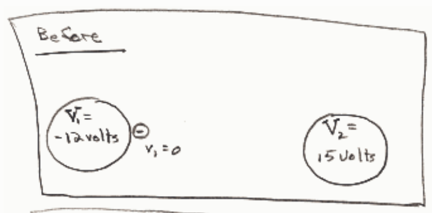
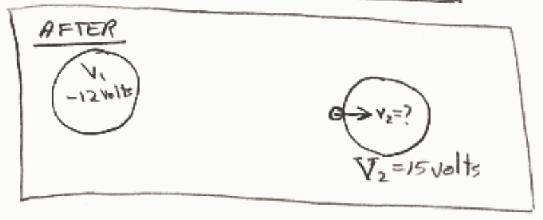

$$E_1 = E_2$$

$$\overset{0}{\cancel{K_1}} + U_1 = K_2 + U_2$$

$$qV_1 = \frac{1}{2} m v_2^2 + qV_2$$

$$\frac{1}{2} m v_2^2 = q(V_1 - V_2)$$

$$v_2 = \sqrt{\frac{2q}{m}(V_1 - V_2)}$$

$$= \sqrt{\frac{2(-1.6 \times 10^{-19}\ \text{C})}{9.11 \times 10^{-31}\ \text{kg}}(-12\ \text{volts} - 15\ \text{volts})}$$

$$\boxed{v_2 = 3.1 \times 10^{6}\ \frac{\text{m}}{\text{s}}}$$

## Question 3

## 0 of 20 points

Two perfectly conducting spheres are in an evacuated region of space. One is at a potential of -1200 volts and the other is at a potential of 1500 volts. A free electron is released from rest at the surface of the sphere at -1200 volts. With what kinetic energy does it crash into the other sphere?

Selected Answer: ✗ There is no way it would ever crash into the other sphere. It is already at the lowest potential in the region.

Correct Answer: ✓ 2700 eV

Feedback: This is a conservation of energy problem. Sought is the kinetic energy of the electron at the last instant prior to the collision. Since we are not asked about velocity we should NOT use $K = \frac{1}{2} mv^2$, and, because of that and the fact that the answers are all given in eV, there is no need to work in SI
