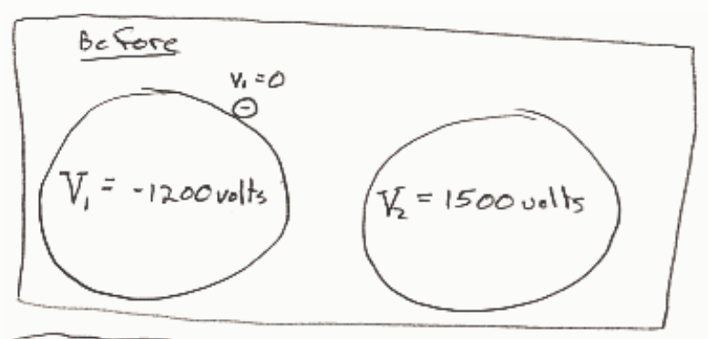
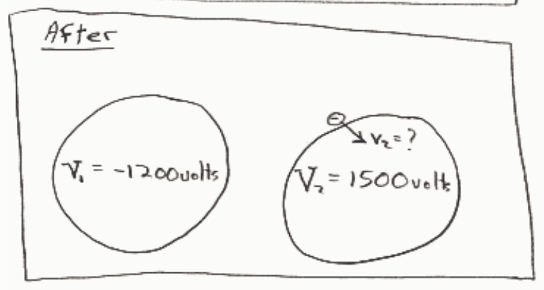

units.

$$E_1 = E_2$$

$$\overset{0}{\cancel{K_1}} + U_1 = K_2 + U_2$$

$$qV_1 = K_2 + qV_2$$

$$K_2 = qV_1 - qV_2$$

$$K_2 = (-1e)(-1200\ \text{volts} - 1500\ \text{volts})$$

$$\boxed{K_2 = 2700\ \text{eV}}$$

## Question 4

## 0 of 20 points

Two perfectly conducting spheres are in an evacuated region of space. One is at a potential of -1200 volts and the other is at a potential of 1500 volts. A free electron is released from rest at the surface of the sphere at -1200 volts. With what kinetic energy does it crash into the other sphere?

Selected Answer: ✗ There is no way that the electron would ever crash into the other sphere.

Correct Answer: ✓ $4.3 \times 10^{-16}\ \text{J}$

Feedback: This is a conservation of energy problem. Sought is the kinetic energy of the electron at the last instant prior to the collision. Since we are not asked about velocity we should NOT use $K = \frac{1}{2} mv^2$. Under these circumstances, it is convenient to use the eV as the unit of energy, but, since the answers are given in Joules we will have to convert the result to joules.
