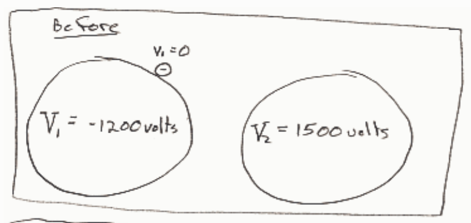
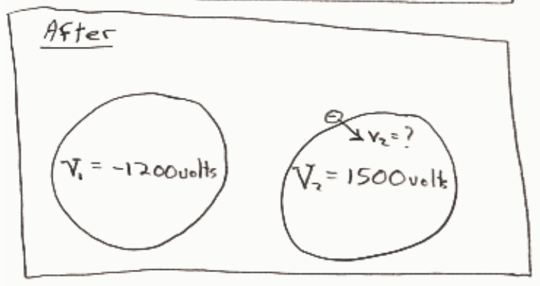

$$E_1 = E_2$$

$$\overset{0}{\cancel{K_1}} + U_1 = K_2 + U_2$$

$$qV_1 = K_2 + qV_2$$

$$K_2 = qV_1 - qV_2$$

$$K_2 = (-1e)\left(-1200\ \text{volts} - 1500\ \text{volts}\right)$$

$$K_2 = 2700\ \text{eV}$$

$$K_2 = 2700\left(1.6 \times 10^{-19}\ \text{C}\right)\left(1\ \frac{\text{J}}{\text{C}}\right)$$

$$\boxed{K_2 = 4.3 \times 10^{-16}\ \text{J}}$$

## Question 5

## 0 of 20 points

Which statement about the electric potential of a solid object made out of a perfectly conducting medium is most correct?

Selected Answer: ✗ The electric potential everywhere in and on the conductor must be zero.
