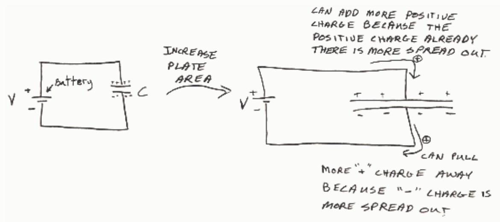
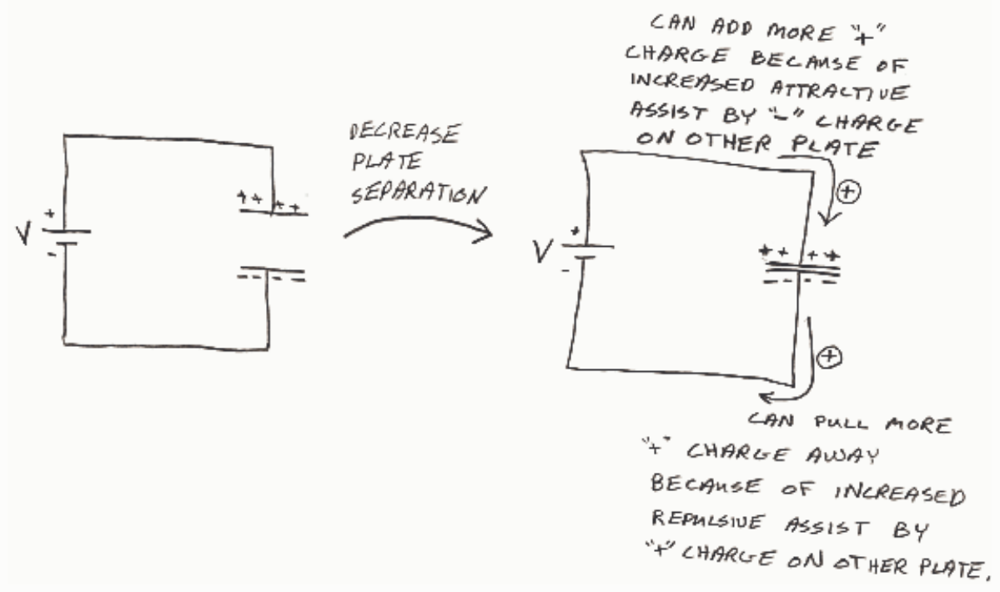

same battery can move more charge from one plate to the other, meaning the capacitor stores more charge for the same voltage, meaning the capacitance is increased.

Now suppose the plates are moved closer together. The negative charge on the negative plate still makes it hard to pull positive charge off, but, the positive charge on the plate on the other side of the gap actually helps the battery pull positive charge from the negative plate by repelling that positive charge away from the capacitor. The closer the plates are to each other the greater this assist and hence, the more positive charge the battery can pull from the negative plate. As the battery pushes that charge onto the positive plate the battery gets an assist from the negative charge on the negative plate on the other side of the gap. (The negative charge exerts a force which tends to pull the positive charge onto the capacitor. So, moving the plates closer together makes it so that the same battery can move more charge from one plate to the other. Thus for the same voltage, the capacitor has more charge. This means that the closer the plates are to each other, the greater the capacitance of the capacitor.

The two situations are depicted schematically below.

