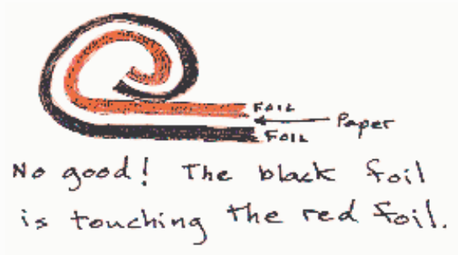

Suppose that you were given a capacitor having capacitance $C$ and that for various voltage settings of a power supply, you measured the voltage across the capacitor and the charge on the capacitor. Assume that your results are ideal. If you made a graph of the charge on the capacitor vs. the voltage across the capacitor, on what kind of curve or line would your data points fall.

Selected Answer: ✗ An increasing exponential curve.

Correct Answer: ✓ A straight line of slope $C$ passing through the origin.

Feedback: The charge on a capacitor is directly proportional to the voltage across the capacitor. The proportionality constant is the capacitance of the capacitor, $C$. A graph of charge vs. voltage thus yields a straight line passing through the origin with slope $C$.

## Question 4

## 20 of 20 points

What do we mean when we say that a capacitor has an amount of charge $Q$ on it?

Selected Answer: ✓ One of the plates of the capacitor holds a charge $Q$ and the other holds a charge –$Q$.

Correct Answer: ✓ One of the plates of the capacitor holds a charge $Q$ and the other holds a charge –$Q$.

Feedback: Good!
If we take the expression "the charge on the capacitor" too literally, the value is always zero because the charge on one plate of a capacitor is always equal to the negative of the charge on the other plate. The expression is physics jargon and we just have to remember that it means the absolute value of the charge on either plate. So, if one plate has 15 mC of charge on it, the other plate has –15 mC of charge on it, and the capacitor is said to have a charge of 15 mC on it.

## Question 5

## 0 of 20 points

You are provided with two strips of metallic foil, two strips of waxed paper, and two metal paper clips. Each strip is in the shape of a rectangle, 2 inches wide and 5 feet long. Which of the following would result in the best capacitor?

Selected Answer: ✗ Layer the strips, alternating metal with paper. Roll up the stack into the shape of a 2-inch-long cylinder. Attach one paper clip to one of the pieces of waxed paper and the other to the other piece of waxed paper. The paper clips serve as the terminals of the capacitor.

Correct Answer: ✓ Layer the strips, alternating metal with paper. Roll up the stack into the shape of a 2-inch-long cylinder. Attach one paper clip to one of the pieces of foil and the other to the other piece of foil. The paper clips serve as the terminals of the capacitor.

Feedback: If you just sandwich one strip of waxed paper in between the two strips of metal foil without using the second strip of waxed paper, the two pieces of foil will come in contact with each other when you roll up the "sandwich" shorting out your would-be capacitor.

