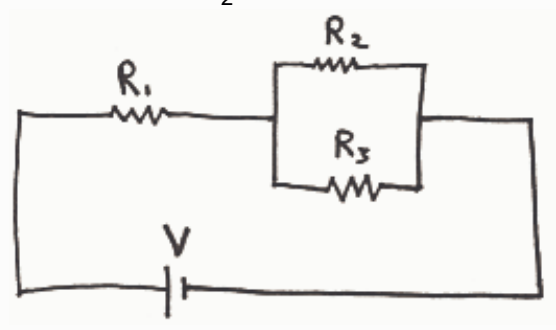
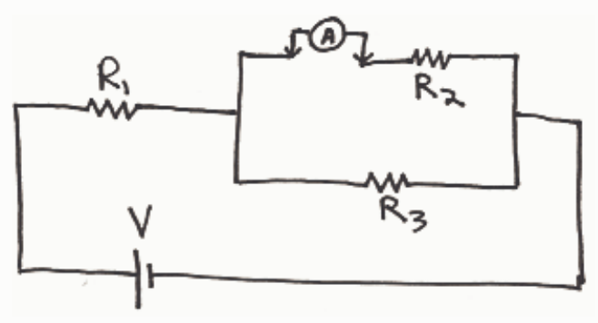

through the second resistor, the exact same amount of charge must be pushed through the third. So for any amount of charge going through the first resistor, the exact same amount of charge goes through the second and third resistors. Hence, for any amount of charge-per-second going through the first resistor, there is the same amount of charge-per-second going through the second resistor and the third resistor. That is to say that the current is the same in all three resistors.

Putting resistors in series has an additive effect on the overall resistance to the flow of charge. The charge flow in a circuit is restricted if, in traveling through the circuit, charge is forced to work its way through a resistor. If, having made its way through one resistor, the charge has no choice but to work its way through a second resistor, as is the case for two resistors in series, then that second resistor further restricts the flow of charge. And if, having made its way through two resistors, one after another, the charge has no choice but to work its way through a third resistor, as is the case for three resistors in series, then that third resistor further restricts the flow of charge. The more the flow of charge is restricted, the greater the overall resistance, so, the resistance of three resistors in series is greater than the resistance of any one of the resistors by itself. The total resistance is, in fact, the sum of the three individual resistances.

## Question 3

0 of 20 points

For this circuit, which of the following represents a correct way of connecting an ammeter to measure the current through resistor  $R_{2}$ ? (Indicate all the correct answers.)

Selected Answers: √

Correct Answers: √
