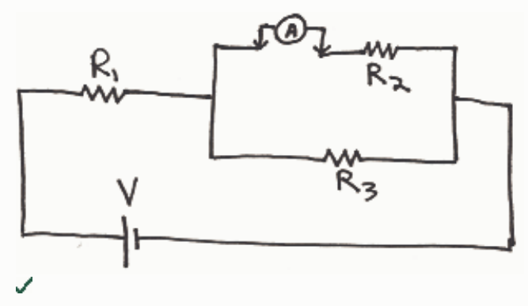
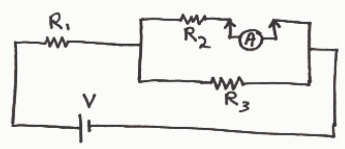
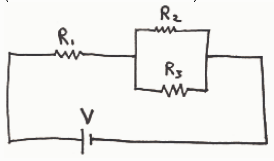

Feedback: An ammeter acts like a piece of wire that measures the charge flow rate through itself. To use it, in principle, one simply removes a piece of wire in that branch of the circuit through which one wishes to measure the current, and replaces that piece of wire with the ammeter.

A branch of a circuit is also known as a leg of a circuit. It is a single conducting path with no "forks in the road." If the circuit consists of only one single conducting path, there is but one branch to the circuit--the whole circuit is the one and only branch of the circuit. If the circuit has junctions where three or more wires meet, then the circuit has more than one branch. Each single conducting path extending from one junction to another, with no junctions in between, is a branch of the circuit. The current everywhere in a branch of a circuit has one and the same value.

To measure the current through $R_2$, in principle, one has to remove a section of wire from the branch containing $R_2$ and replace that section of wire with an ammeter. In practice, this is the same as disconnecting the wire from $R_2$, connecting one end of the ammeter to the end of the wire just disconnected from $R_2$ and the other end of the ammeter to the terminal of $R_2$ from which the wire was removed.

Question 4 0 of 10 points

For this circuit, which of the following shows a correct way to connect a voltmeter to measure the voltage across $R_2$? (Indicate all the correct answers.)

Selected Answers: $\times$
