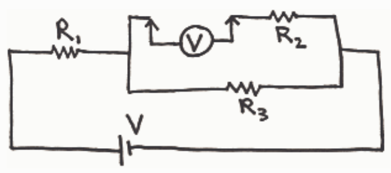
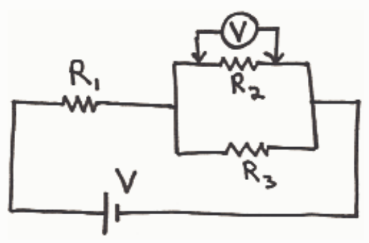

Correct Answers: √

Feedback: An ideal voltmeter has infinite resistance. As regards the effect it has on the circuit, a voltmeter acts like dry air (unlike an ammeter which acts like a piece of wire). A voltmeter has two probes, one marked positive and the other negative. If you connect the positive probe to point A in the circuit and the other to point B in the circuit, the voltmeter shows how much higher the electric potential at A is than that at point B.

(Some, but not all voltmeters allow for negative readings. Point A being at a potential that is -5 Volts higher than the potential at point B is the same as point B being at a potential that is 5 Volts higher than the potential at point A.)

Taking a voltage reading is a passive activity. There is no need to modify the circuit prior to connecting the voltmeter. One simple touches or connects each probe to a point in the circuit.

## Question 5

## 0 of 10 points

A circuit consists of a 10 volt battery connected in series with a 4 ohm resistor and a 6 ohm resistor. A person calculates the current through the 4 ohm resistor using Ohm's Law by dividing 10 volts by 4 ohms. What is wrong with this?

Selected ✗ There is nothing wrong with it. That is exactly what one must do to get the current through the Answer: 4 ohm resistor.

Correct Answer: In using Ohm's Law to determine the current through a resistor, one must use the resistance of the resistor and the voltage across the resistor. One cannot just use any voltage that happens to appear in the circuit. 10 volts is not the voltage across the resistor.

Feedback: The simplest method for correctly determining the current through the 4 ohm resistor in the circuit
