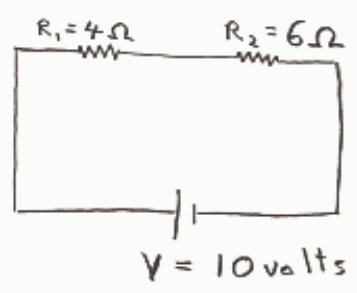
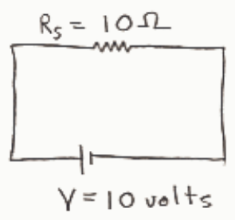

is to use the method of effective resistance. The two resistors are in series so they can be combined to form the single effective resistance $R_S$.

$$R_S = R_1 + R_2$$

$$R_S = 4\ \text{ohms} + 6\ \text{ohms}$$

$$R_S = 10\ \text{ohms}$$

In the simpler circuit the seat of EMF is connected directly across the effective resistance $R_S$. So the voltage across the 10 ohm resistor $R_S$ is the same as the EMF voltage, namely 10 volts. Now we can use Ohm's law:

$$V = I R_S$$

$$I = V / R_S$$

$$I = (10\ \text{volts}) / (10\ \text{ohms})$$

$$I = 1\ \text{ampere}$$

We have found the current through the single effective resistance $R_S$. The last step in the problem is to take what we have found in the simplified circuit and apply it to the original circuit. Because $R_S$ represents a series combination of resistors, the current through $R_S$ is the current through each of the resistors making up $R_S$. So, the current through the 4 ohm resistor labeled $R_1$ in my diagram of the original circuit is 1 ampere.

## Question 6

## 0 of 10 points

A circuit consists of a 10 volt battery connected in series with a 4 ohm resistor and a 6 ohm resistor. Why is it utter nonsense to say that 4 volts goes through the 4 ohm resistor? (Choose the one best answer.)
