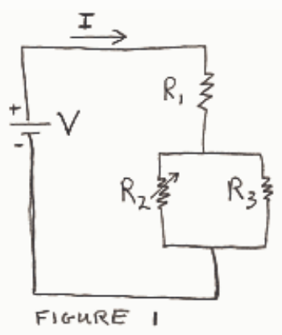
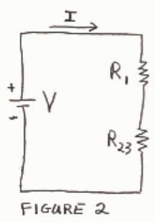
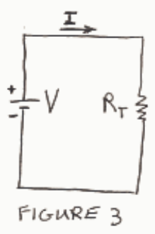

The arrow through $R_{2}$ in Figure 1 means that $R_{2}$ is a variable resistor.

$R_{23}$  in Figure 2 is the effective resistance of the parallel combination of  $R_{2}$  and  $R_{3}$ .

Resistor $R_{T}$ in Figure 3 is the effective resistance of the series combination of $R_{1}$ and $R_{23}$. The increase in $R_{2}$ that causes $R_{23}$ also increases $R_{T}$. Figure 3 shows, based on Ohm's Law, that an increase in $R_{T}$ results in a decrease in current I. The I in Figure 3 is also the I in Figure 2. The given circuit is depicted in Figure 1. Looking at Figure 2 and recognizing that I is the current through $R_{1}$, according to Ohm's Law, the decrease in I results in a decrease in voltage across $R_{1}$. Now the voltage across the series combination $R_{1}$ and $R_{23}$ (the voltage across $R_{1}$ plus the voltage across $R_{23}$) is the voltage across the seat of EMF, which does not change. So if the voltage across $R_{1}$ decreases then the voltage across $R_{23}$ must increase, in order for the sum to stay the same. But the voltage across $R_{23}$ is the voltage across $R_{3}$ so the voltage across $R_{3}$ must increase.
