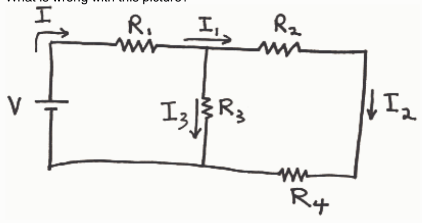

0 of 20 points

In using Kirchhoff's Laws to analyze a circuit, a student correctly calculates a negative value for one of the currents in the circuit. What does the negative sign mean?

Selected Answer:

✗ One of the premises of the question is wrong. A negative sign for a current indicates that there is a mistake in the calculation.

Correct Answer:

✓ The positive sense for the current in question is established by means of an arrow pointing in that direction defined to be the positive direction for current. The negative sign in the result indicates that the current is actually in the direction opposite to that direction specified by the arrow.

## Question 5

0 of 20 points

What is wrong with this picture?

Selected Answer:

✗ $I$, $I_1$, and $I_2$ are all one and the same current.

Correct Answer:

✓ $I_1$ is depicted as going right through a junction. In actuality, where a current meets a junction (of three wires) part of the current goes one way and part of it goes another--it never just goes straight through the junction.

Feedback: Current is the flow rate of charge. When the charge gets to the junction of three wires (including the wire the charge is in) the charge has two options on which way to go. Some goes one way, and some goes the other.
