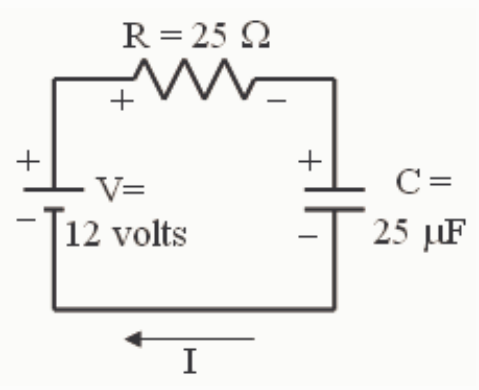

## Question 3

## 0 of 20 points

Consider a capacitor which is charged to 12 volts and then connected across a resistor. Let $t_{1/2}$ be the time it takes for the voltage to drop down to 6 volts. Suppose the experiment is repeated, but with a pair of capacitors connected in parallel with each other in place of the original capacitor, where each element of the pair has the same capacitance as the original capacitor. How does the new $t_{1/2}$ compare with the original $t_{1/2}$?

Selected Answer: ✗ The new $t_{1/2}$ is the same as the original $t_{1/2}$.

Correct Answer: ✓ The new $t_{1/2}$ is twice the original $t_{1/2}$.

Feedback:

$$V = V_o e^{-\frac{t}{\tau}}$$

$t_{1/2}$ is the time it takes for $V$ to decrease to $\frac{1}{2}V_o$. Thus:

$$\frac{1}{2}V_o = V_o e^{-\frac{t_{1/2}}{\tau}}$$

$$\frac{1}{2} = e^{-\frac{t_{1/2}}{\tau}}$$

$$\ln \frac{1}{2} = -\frac{t_{1/2}}{\tau}$$

$$\ln 2 = \frac{t_{1/2}}{\tau}$$

$$\tau \ln 2 = t_{1/2}$$

$$t_{1/2} = \tau \ln 2$$

$$t_{1/2} = RC \ln 2$$

From the development at left we see that the half-life, $t_{1/2}$ is proportional to the capacitance $C$. Now, capacitors in parallel add, so, when we hook two identical capacitors in parallel, the effective capacitance is twice the capacitance of either one alone. Essentially, by hooking an identical capacitor in parallel with one in a circuit, we are doubling the capacitance. Since, as we have shown, the half-life, $t_{1/2}$ is proportional to the capacitance $C$, when we double $C$ we double the half-life. That is to say that the new half-life is twice the original half-life.

## Question 4

## 0 of 20 points

Consider a capacitor which is charged to 12 volts and then connected across a resistor. Let $t_{1/2}$ be the time it takes for the voltage to drop down to 6 volts. Suppose the experiment is repeated, but with a pair of capacitors connected in series in place of the original capacitor, where each element of the pair has the same capacitance as the original
