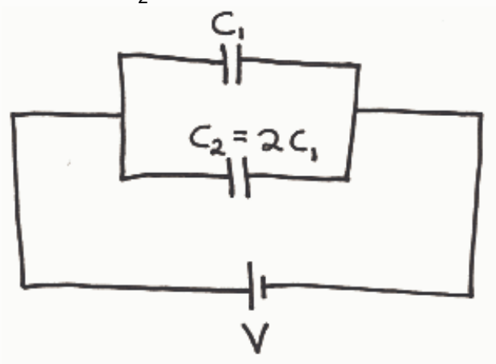

## Review Assessment: q14

Name: q14

Status : Completed

Score: 15 out of 100 points

## Instructions:

## Question 1

## 0 of 20 points

A 12 Volt battery is connected across a parallel combination of two capacitors,  $C_{1}$  and  $C_{2}$ . The capacitance of  $C_{2}$  is twice that of  $C_{2}$ .

## Question

Which capacitor has the greater charge?

Across which capacitor is the voltage greater?

## Correct Match

B.  $C_{2}$

√ C. Neither. It is the same for both capacitors. ✗ A. C₁

## Selected Match

× A.  $C_{1}$

× A.  $C_{1}$

Feedback: Here we indicate the two unique conductors in the circuit by coloring one blue, and one yellow:
