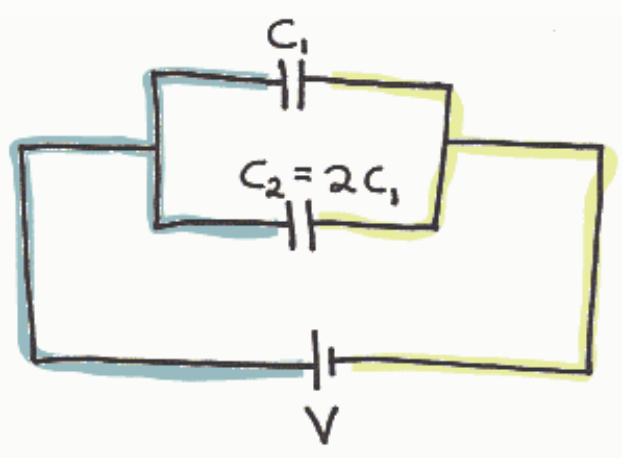
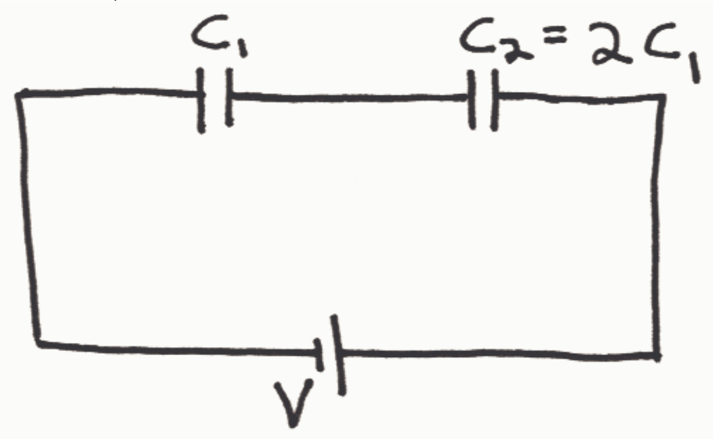

The voltage across $C_1$ is the potential difference between the terminals of $C_1$. One terminal of capacitor $C_1$ is on the blue conductor and the other is on the yellow conductor. Hence the potential difference between the terminals of $C_1$ is the potential difference between the blue conductor and the yellow conductor. Thus the voltage across $C_1$ is the potential difference between the blue conductor and the yellow conductor. But the same can be said of capacitor $C_2$. The voltage across $C_2$ is also the potential difference between the blue conductor and the yellow conductor. Hence, the voltage across $C_2$ is the same as the voltage across $C_1$.

Now the charge on a capacitor is given by Q=CV. So, for two capacitors having one and the same voltage, the capacitor with the larger capacitance is going to have the greater charge.

## Question 2

## 10 of 20 points

A 12 volt battery is connected across a series combination of two capacitors, $C_1$ and $C_2$. The capacitance of $C_2$ is twice that of $C_1$.

<table><tr><td>Question</td><td>Correct Match</td><td>Selected Match</td></tr></table>
