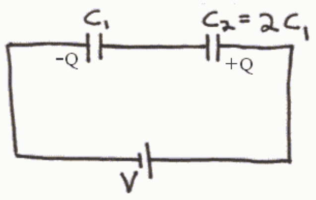
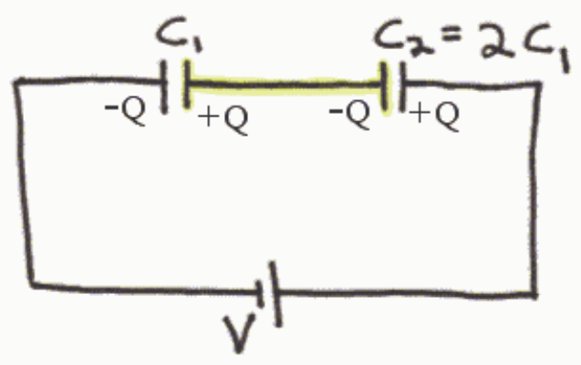

Suppose the seat of EMF moves an amount of charge $Q$ from the left side of $C_1$ to the right side of $C_2$. This leaves $-Q$ on the left plate of $C_1$ and puts $+Q$ on the right plate of $C_2$. Now check out the conductor in the middle, highlighted in yellow here:

That conductor is isolated from the surroundings. It starts out neutral and because it is isolated from the surroundings it remains neutral, but, charge can move around within it. Positive charge on the right side of this conductor (the left plate of $C_2$) is repelled by the positive charge on the right plate of $C_2$. It is also attracted by the negative charge on the left plate of $C_1$. So, positive charge moves from the left plate of $C_2$ to the right plate of $C_1$. This causes a buildup of positive charge on the right plate of $C_1$ and leaves negative charge on the left plate of $C_2$. The charge keeps moving until there is no more negative charge on the left plate of $C_1$ then there is positive charge on the right plate. That is, a total amount of charge $Q$ moves from the left plate of $C_2$ to the right plate of $C_1$. Thus, each capacitor has charge $Q$ on one of its plates and $-Q$ on the other. So each capacitor has one and the same value of charge, $Q$. (Recall that when a capacitor is said to have charge $Q$, it really has $-Q$ on one plate and $+Q$ on the other.) Admittedly, one can simply memorize the fact that for capacitors in series, every capacitor in the series combination has one and the same value of charge, but, one will be better able to solve problems if one can picture the redistribution of charge that results in the fact that every capacitor in a series combination of capacitors must have one and the same value of charge. Once the charge issue is settled, the voltage question is easy. Solving the defining equation for capacitance, $Q=CV$, for $V$ we get $V=Q/C$. Since both capacitors have the same charge, and, because the "C" in this equation is in the denominator, the capacitor with the greater capacitance will have the smaller voltage.

## Question 3

## 5 of 35 points
