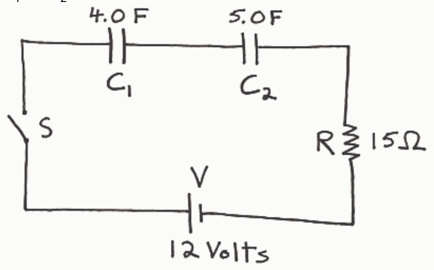

$C_1$ and $C_2$ are initially uncharged.

<table><tr><td>Question</td><td>Correct Match</td><td>Selected Match</td></tr><tr><td>At the instant the switch is closed, what is the voltage across resistor R?</td><td>✓ D. 12 Volts</td><td>✗ A. 0 Volts</td></tr><tr><td>At the instant the switch is closed, what is the current through resistor R?</td><td>✓ F. 0.80 Amperes</td><td>✗ A. 0 Volts</td></tr><tr><td>After the switch has been closed a very long time, so long that neither of the capacitors is still charging, what is the current through the resistor R?</td><td>✓ E. 0 Amperes</td><td>✗ A. 0 Volts</td></tr><tr><td>At the instant the switch is closed, what is the voltage across \( C_1 \)?</td><td>✓ A. 0 Volts</td><td>✓ A. 0 Volts</td></tr><tr><td>At the instant the switch is closed, what is the charge on \( C_1 \)?</td><td>✓ G. 0 Coulombs</td><td>✗ A. 0 Volts</td></tr><tr><td>After the switch has been closed a very long time, so long that neither of the capacitors is still charging, what is voltage across \( C_1 \)?</td><td>✓ C. 6.7 Volts</td><td>✗ A. 0 Volts</td></tr><tr><td>After the switch has been closed a very long time, so long that neither of the capacitors is still charging, what is charge on \( C_1 \)?</td><td>✓ H. 27 Coulombs</td><td>✗ A. 0 Volts</td></tr></table>

Feedback: Just for an infinitesimal time interval, starting at the first instant after the switch is closed, because the capacitors are uncharged, it is so easy to pull charge from one side of the capacitor and put it on the other that the capacitors act like pieces of wire--like perfect conductors. Replacing the capacitors, conceptually, with pieces of wire makes it so that the seat of EMF is connected directly across the resistor. So the voltage across the resistor, at the first instant in time after the switch is closed, is 12 Volts. It decreases steadily from there.

Question 4 0 of 25 points

Consider a pair of two identical capacitors. In which case is the capacitance of the pair greater?

Selected Answer: ✗ When they are connected in series with each other.

Correct Answer: ✓ When they are connected in parallel with each other.

Feedback: The effective capacitance of a pair of capacitors in series, $C_s$, is given by

$$
\mathrm{C}_{s} = 1/(1/\mathrm{C}_{1} + 1/1/\mathrm{C}_{2})
$$

For the case of two capacitors with one and the same capacitance C:

$$
C_1 = C
$$

and
