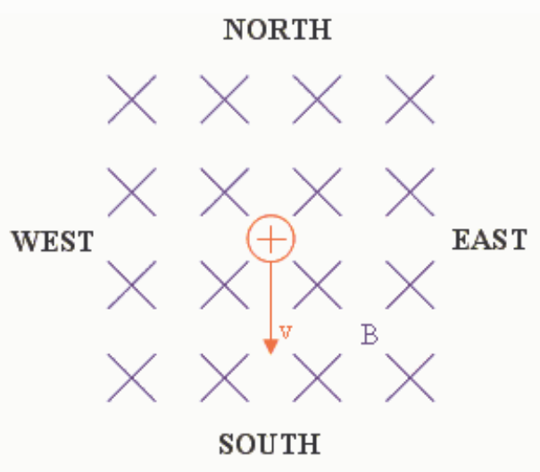

In the diagram just above we depict the downward-directed magnetic field by means of x's which are supposed to resemble the tail feathers of arrows that point into the screen which we define to be downward in the diagram.

The force on a charged particle that is moving in a magnetic field is given by

$$\vec{F} = q \vec{v} \times \vec{B}$$

We use the right-hand rule for the cross product of two vectors to determine the direction of

$$\vec{v} \times \vec{B}$$

To apply the right hand rule, we point the fingers of the right hand in the direction of the first vector (the velocity vector) and then orient the hand so that if we briefly close the fingers, they point in the direction of the second vector (the magnetic field vector). I find that if I arrange my right hand with the fingers pointed toward the bottom of the screen (the direction of the first vector, the velocity vector) and the palm facing toward the screen, then when I briefly close the fingers they do indeed point into the screen, in the direction of the second vector, the magnetic field vector. With the hand so oriented the thumb points toward the right side of the screen, which means the cross product of

$$\vec{v} \times \vec{B}$$

is eastward. But, in the expression for the force, there is a charge q multiplying

$$\vec{v} \times \vec{B}$$

In the case at hand, the charge is positive, so the direction of the force

$$\vec{F} = q \vec{v} \times \vec{B}$$

is the same as the direction of

$$\vec{v} \times \vec{B}$$
