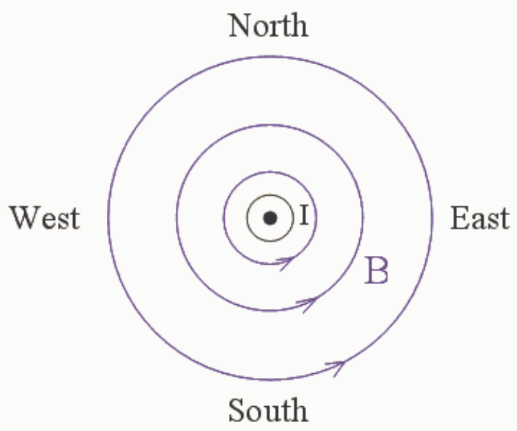
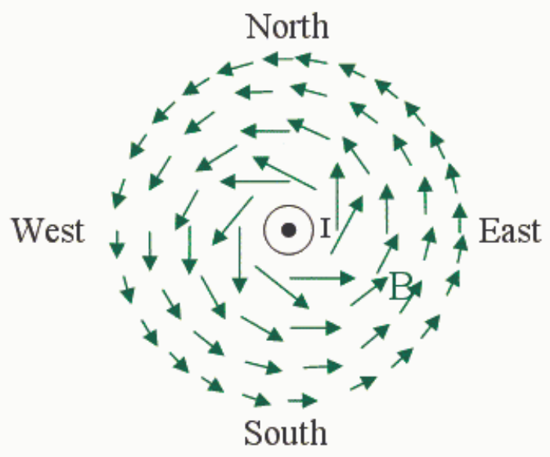

## VIEW FROM ABOVE

Check out the diagram above. We have already put the magnetic field lines, established by means of the right hand rule for something curly something straight*, on the diagram.

It is important to realize that a magnetic field diagram is a graphical representation of a magnetic field and a magnetic field is an infinite set of vectors, one at each point in the region of space where the magnetic field exists. Consider the unconventional graphical representation of the same magnetic field in the diagram below.

In this diagram we represent the magnetic field by means of an arrow for each of many of the infinite set of points in the region of space where the magnetic field exists. Each arrow characterizes the magnetic field at the point at the tip of the tail of the arrow itself. The direction of the magnetic field, at the point at the tip of the tail of an arrow, is represented by the direction in which the arrow is pointing, and, the magnitude of the magnetic field is represented by the length of the arrow. This diagram illustrates what we are saying about the magnetic field vectors themselves when we say that the magnetic field lines form loops around the current.
