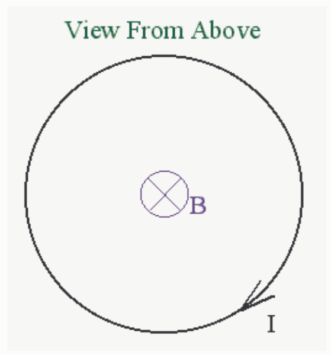

The direction of the magnetic field at the center of a horizontal current-carrying loop of wire is straight downward. The magnetic field is caused by the current in the loop. What is the direction of the current?

Selected Answer: ✗ Counterclockwise as viewed from above.

Correct Answer: ✓ Clockwise as viewed from above.

Feedback: Given a conducting wire in the form of a loop, and given the current in that loop, we can apply the right hand rule to determine the direction of the magnetic field at the center of that loop. All we have to do is to curl the fingers of the right hand around in the direction of the current and the extended thumb of the cupped right hand will point in the direction of the magnetic field inside at the center of the loop. Interestingly enough, this procedure is reversible. That is, if we are not told the direction of the current, but we know the direction of the magnetic field at the center of the loop, all we have to do is point the extended thumb of the cupped right hand in the direction of the magnetic field at the center of the loop and the fingers will indicate the direction in which the current must be flowing around the loop to produce such a magnetic field. In the case at hand, pointing the thumb downward (toward the center of the earth) we find that the fingers curl in the clockwise direction, as viewed from above. Thus the current is clockwise, in the loop, as viewed from above.

This is one of those problems in which we are given some information about the effect of something (the effect of the current in this case) and asked to find something about the cause (the current itself in this case). The right hand rule comes in "handy" for this one (pun intended).

