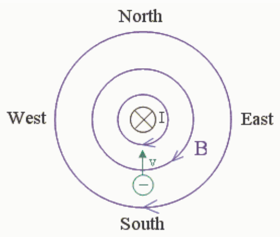

dia- means against or in direct opposition to as in "diametrically opposed".

## Question 3

## 0 of 20 points

A negatively charged particle is headed due north, straight toward a straight vertical wire which carries a downward current. What is the direction of the force, if any, exerted on the charged particle by the magnetic field of the current-carrying conductor?

Selected Answer: ✗ There is no force exerted on the charged particle.

Correct Answer: ✓ Downward.

Feedback:

The situation is depicted in the figure above. As viewed from above, the downward-directed current I is depicted as an x with a circle around it.

Using the right-hand rule for something curly something straight we realize that the magnetic field extends in circles, clockwise, as viewed from above, about the current-carrying conductor. At a specific point in space the magnetic field always has a straight-line direction. (It is nonsense to say that, at the location of the charged particle, the magnetic field is clockwise.) At the location of the negatively-charged particle we note that the magnetic field is westward.

The force on the charged particle is given by

$$\vec{F} = q\vec{v} \times \vec{B}$$

By the right-hand rule for the cross product of two vectors, the direction of $\vec{v} \times \vec{B}$ is upward (out of the screen in the diagram). Multiplying this by the negative charge of the particle flips the direction yielding downward for the direction of the force.

## Question 4

## 0 of 15 points

The outer surface of a short, vertical segment of plastic pipe is hidden from view by wire wrapped around the pipe. Current flows clockwise, as viewed from above, in the wire. What is the direction of the magnetic field produced by the wire at a point inside the pipe?

Selected Answer: ✗ Radially outward from the axis of symmetry.

Correct Answer: ✓ None of the other answers are correct.

Feedback: We determine the direction of the magnetic field by means of the right hand rule for something curly something straight. We curl the fingers of our right hand around in the direction of the current. The
