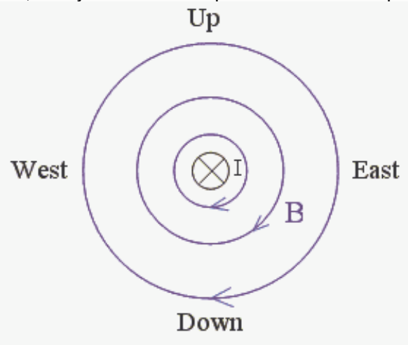

thumb then points downward so the direction of the magnetic field is downward.

## Question 5

## 0 of 15 points

What is the direction of the magnetic field at a point due east of a straight wire carrying a current due north?

Selected Answer: ✗ Northward.

Correct Answer: ✓ Downward.

Feedback: Check out the following view (looking northward) from the south. Note that "toward the top of the page" is upward and "into the page" is northward. The current is northward as depicted by the x with the circle around it, the symbol used to represent the "into the page" direction.

Using the right-hand rule for something curly something straight we realize that the magnetic field extends in circles, clockwise, as viewed from the south, about the current-carrying conductor. Thus, looking at the diagram, we see that, at a point due east of the wire, the magnetic field is downward.

## Question 6

## 0 of 15 points

Where is the magnetic field due to a bar magnet strongest?

Selected Answer: ✗ At those points on that cyliner whose radius is equal to half the length of the magnet, which is centered on the center of the magnet, and, for which the magnet lies on the axis of symmetry of the cylinder.

Correct Answer: ✓ Inside the magnet.

Feedback: This is just an experimental fact.
