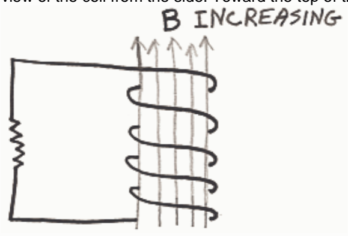

## Review Assessment: q18

Name: q18

Status : Completed

Score: 45 out of 100 points

## Instructions:

## Question 1

## 10 of 30 points

Match the Name of the Law to the Law.

<table><tr><td>Question</td><td>Correct Match</td><td>Selected Match</td></tr><tr><td>Lenz&#x27;s Law</td><td>√ F. The magnetic field produced by the current that is induced to flow in a loop or coil by a change in the number of magnetic field lines through that loop or coil is in that direction which tends to keep the number of magnetic field lines through the loop or coil at its original value in the original direction.</td><td>✗ A. An electric current causes a magnetic field.</td></tr><tr><td>Ampere&#x27;s Law</td><td>√ A. An electric current causes a magnetic field.</td><td>√ A. An electric current causes a magnetic field.</td></tr><tr><td>Faraday&#x27;s Law of Induction</td><td>√ D. A changing magnetic field causes an electric current.</td><td>✗ A. An electric current causes a magnetic field.</td></tr></table>

Feedback: Faraday's Law of Induction states that if the number of magnetic field lines through a loop or coil is changing, then a current will be induced in that loop or coil. Lenz's Law is the one that allows us to determine the direction of that current.

Ampere's law is simpler. It just states that electric current causes a magnetic field.

## Question 2

## 0 of 15 points

Indicate the direction of the current, if any, induced to flow in the coil by the changing magnetic field. (Depicted is a view of the coil from the side. Toward the top of the screen in the diagram, is upward.)

Selected Answer: ✗
