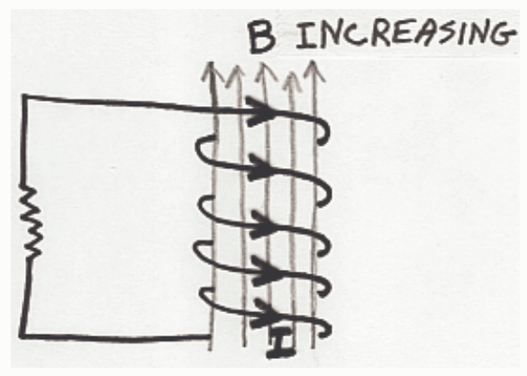
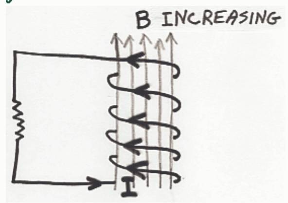
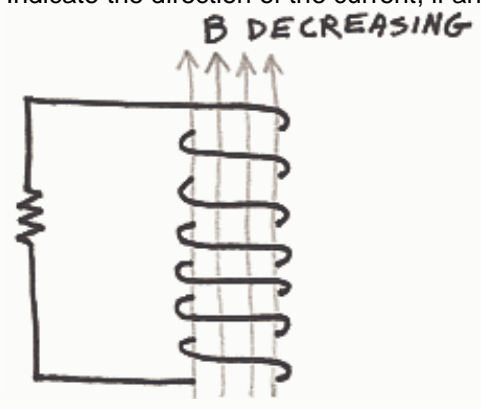

Correct Answer:

Feedback: The key to applying Lenz's Law is figuring out what change in the magnetic field through the coil is occurring and establishing what direction a new magnetic field would have to be in to fight that change. Here we have an up-through-the-coil magnetic field which is increasing. To fight that increase we need a down-through-the-coil magnetic field. Thus,  $B_{pin}$ , the magnetic field produced by the induced current, must be down-through-the-coil.

Now we have to ask our self, "In what direction must the current flow around in the coil in order to produce a downward-through-the-coil directed magnetic field. The magnetic field is the straight thing in this problem so we point our right thumb in the down-through-the-coil direction and note that our fingers then curl around in the clockwise, as viewed from above, direction.

## Question 3

15 of 15 points

Indicate the direction of the current, if any, induced to flow in the coil by the changing magnetic field.

Selected Answer:
