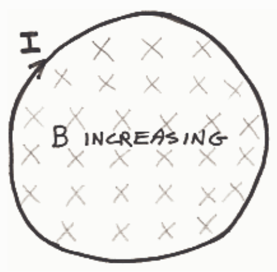
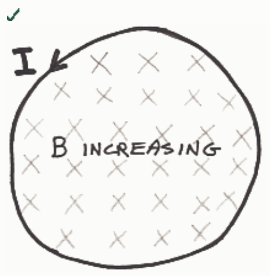
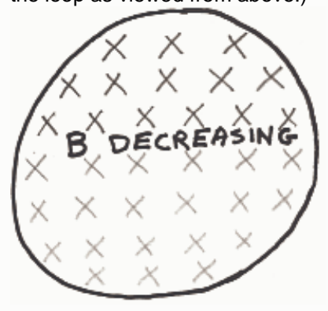

Correct Answer:

## Feedback: Well done!

1. Given: Increasing number of magnetic field lines downward through loop.

2. By Faraday's Law of Induction, 1 above induces current in loop.

3. By Ampere's Law, induced current produces new magnetic field  $B_{PIN}$  through loop.

4. By Lenz's Law,  $B_{PIN}$  is upward (out of page) to cancel new downward magnetic field lines.

5. By right-hand rule for something curly something straight, induced current (referred to in step 2) must be counterclockwise, as viewed from above, to produce upward  $B_{PIN}$ .

## Question 5

## 20 of 20 points

Indicate the direction of the current, if any, induced to flow in the loop by the changing magnetic field. (Depicted is the loop as viewed from above.)

Selected Answer: ✓
