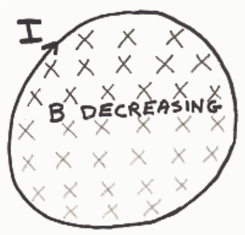
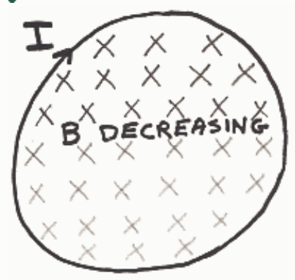

Correct Answer:

## Feedback: Nice work!

1. Given: Decreasing number of magnetic field lines downward through loop.

2. By Faraday's Law of Induction, 1 above induces current in loop.

3. By Ampere's Law, induced current produces new magnetic field  $B_{PIN}$  through loop.

4. By Lenz's Law,  $B_{PIN}$  is downward (into page) to make up for loss of downward magnetic field lines.

5. By right-hand rule for something curly something straight, induced current (referred to in step 2) must be clockwise, as viewed from above, to produce downward  $B_{PIN}$ .
