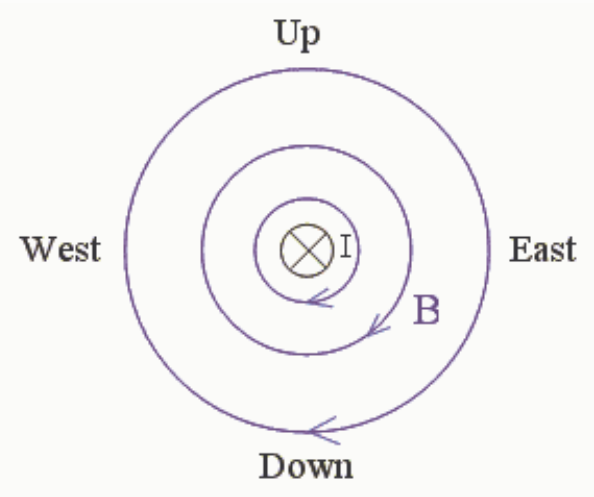
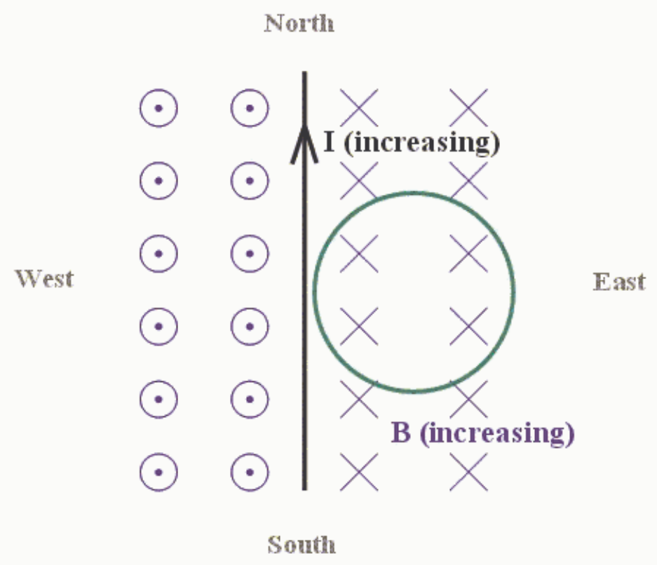

By the right hand rule for something curly something straight, the magnetic field extends in clockwise, as viewed from the south, circles. Because the current is increasing the magnetic field is increasing. From this diagram, it is evident that at any position due east of the wire, the magnetic field due to the wire is downward (toward the center of the earth).

Now lets look at the same straight wire from above. This time we include the loop, mentioned in the question, in the picture.

In this picture, downward is into the page. We can see that the increasing current in the straight wire results in an increasing number of magnetic field lines downward through the loop.

1. Given: Increasing number of magnetic field lines downward through loop.

2. By Faraday's Law of Induction, 1 above induces current in loop.

3. By Ampere's Law, induced current produces new magnetic field $B_{\mathrm{PIN}}$ through loop.

4. By Lenz's Law, $B_{\mathrm{PIN}}$ is upward (out of page) through the loop to cancel new downward magnetic field lines.
