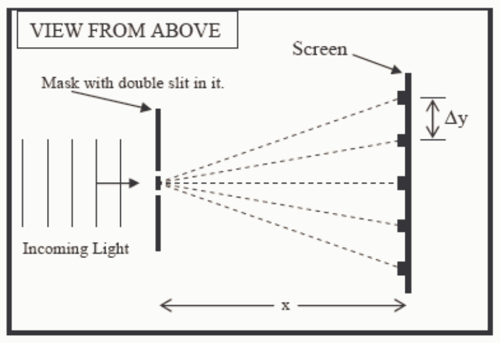

The equation $m\lambda = d\sin\theta$ solved for $\sin\theta$ yields $\sin\theta = \frac{m\lambda}{d}$.

Since the slit spacing d is in the denominator of the expression for $\sin\theta$, a decrease in $d$ results in an increase in $\sin\theta$.

In that $\theta$ is the angle from the straight ahead direction (the direction perpendicular to the mask with the two slits in it), any angle greater than $90^{\circ}$ would be inconsistent with the interference phenomenon in question—an angle greater than $90^{\circ}$ would mean that the light impinging on the double slit, bounces off of it rather than going through it. For values of $\theta$ between 0 and $90^{\circ}$, an increase in $\theta$ corresponds to an increase in $\sin\theta$.

Hence, a decrease in $d$ results in an increase in $\theta$. From the geometry of the Young's double slit configuration, an increase in the angle $\theta$ for each bright fringe, results in a greater bright-fringe spacing (the distance labeled $\Delta$y in the diagram below) on the screen.

In that $\lambda$ is in the numerator of the expression $\sin\theta = \frac{m\lambda}{d}$, an increase in the value of $\lambda$ has the exact same effect that a decrease in the value of $d$ has. That is to say, that an increase in the value of the wavelength $\lambda$ of the incoming light also results in a greater bright-fringe spacing $\Delta$y.

The distance x in the diagram above is the distance from the mask with the two slits in it to the screen. Note that this distance does not appear in the interference equation $\sin\theta = \frac{m\lambda}{d}$. There is no convention for the symbol used to represent this distance. People typically use $D$, $L$, or, as in the diagram above, x, to represent this distance. It should never be confused with the distance $d$ which is the slit separation, the distance from the center of one slit in the mask to the center of the other slit in the mask. The change in the bright-fringe spacing that occurs when the slit-to-screen distance x,
