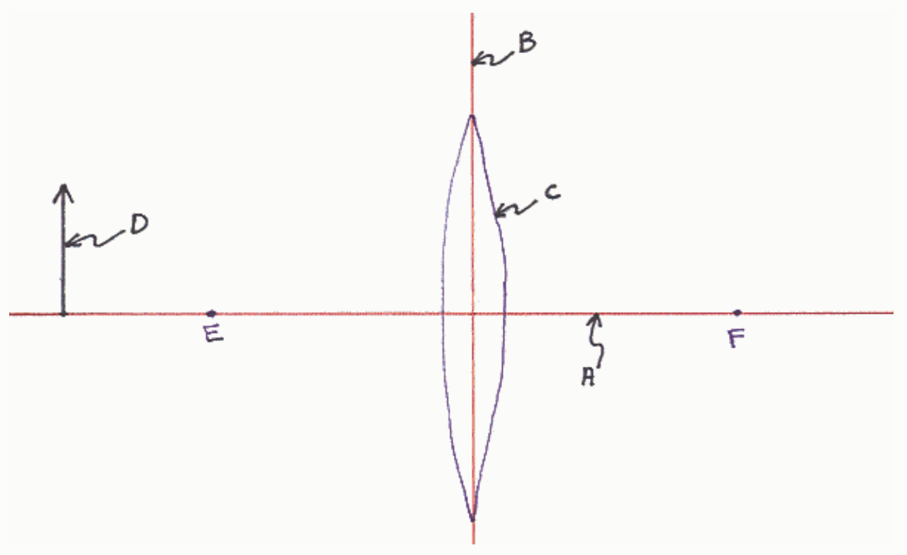

## Question

That focal point on the opposite side of the lens as the object.

That focal point on the same side of the lens as the object.

The plane of the lens.

The principal axis of the lens.

An icon representing the lens.

The object.

## Correct Match Selected Match

√ F. [None] ✗ A. [None Given]

√ E. [None] ✗ A. [None Given]

√ B. [None] ✗ A. [None Given]

√ A. [None] √ A. [None Given]

√ C. [None] ✗ A. [None Given]

√ D. [None] ✗ A. [None Given]

Feedback: I guess the only point I want to stress here is that the lens depicted in a ray tracing diagram is just an indicator to the reader as to what kind of lens is being analyzed. All abrupt changes in ray path are drawn as occurring at the plane of the lens, not at the surface of the lens. Principle rays are not required to appear to pass through the lens in the ray-tracing diagram. Whether or not they appear to pass through the lens just depends on how big the person drawing the icon of the lens chose to draw it, a consideration that is irrelevant in determining the position and characteristics of the image.

## Question 3

9 of 9 points

A person is attempting to determine the characteristics of an image formed by a converging lens by means of a ray tracing diagram. The person has drawn one principal ray. What is wrong with the principal ray?
