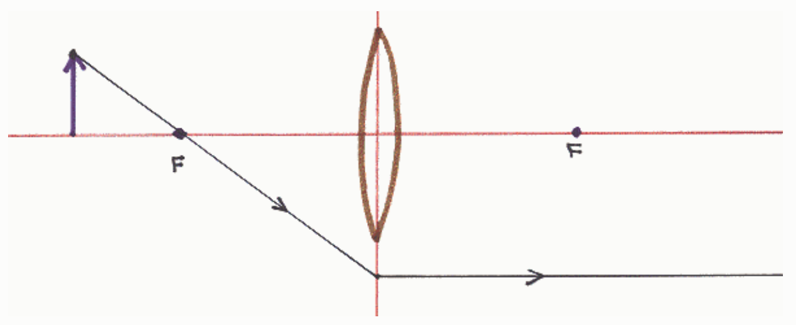
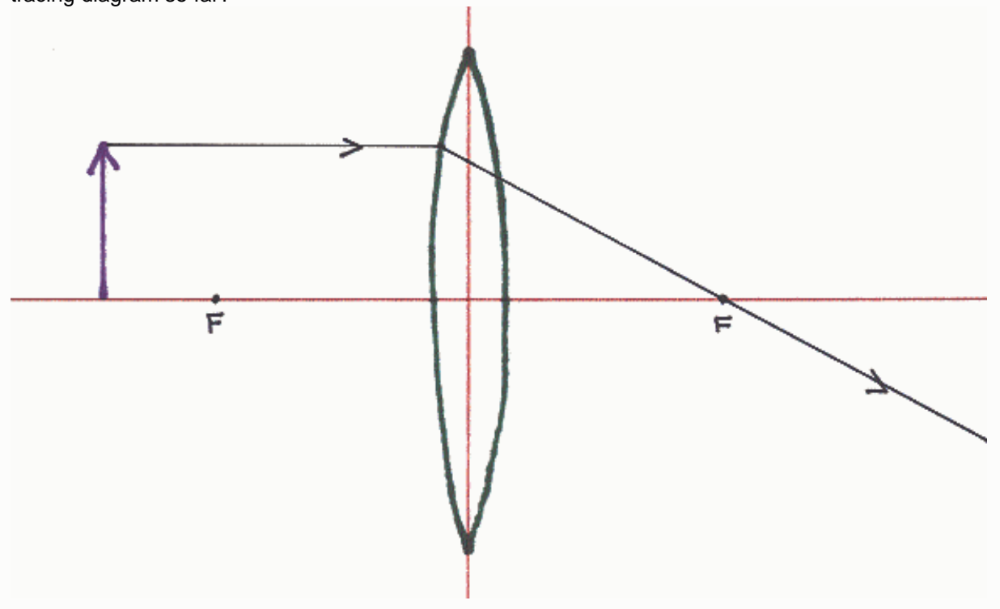

Selected Answer: ✓ Nothing.

Correct Answer: ✓ Nothing.

Feedback: Well done.

For a converging lens, there is indeed a principal ray that leaves the object and from there, travels toward the plane of the lens along a line that passes through the focal point on the same side of the lens as the object. For the case of an object farther from the lens than the focal point, this ray will indeed pass through the focal point on its way to the plane of the lens.

At the plane of the lens, this ray abruptly changes to a path that is parallel to the principal axis of the lens.

## Question 4

0 of 9 points

A person is creating a ray tracing diagram to determine the characteristics of an image formed by a converging lens. So far, the person has gotten as far as drawing one of the principal rays. What is necessarily wrong with the ray tracing diagram so far?

Selected

✗ Nothing is necessarily wrong with the diagram so far.
