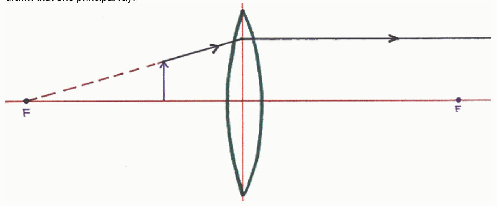

## Answer:

Correct The principle ray is depicted as changing its path at the surface of the lens. In the thin lens approximation central to thin lens ray tracing diagrams, the change of path is supposed to occur at the plane of the lens.

Feedback: The outline of the lens is just an icon telling the reader what kind of lens one is dealing with. Its boundaries are never to be taken as the actual outline of the lens.

## Question 5

## 9 of 9 points

A person is determining the characteristics of the image formed by a converging lens by means of a ray tracing diagram. The person has gotten as far as drawing one principal ray. What is wrong with the way the person has drawn that one principal ray.

Selected Answer: ✓ Nothing.

Correct Answer: ✓ Nothing.

Feedback: Well done!

The principal ray in question here is the one that travels along a line that passes through the focal point on the same side of the lens as the object. In the case at hand, the object is closer to the lens than the focal point, so, the ray leaves the object and travels directly away from the focal point in order to be on that line, and, to be traveling toward the plane of the lens.

At the plane of the lens this principle ray adopts a new straight line path. The new path is parallel to the principal axis of the lens.

## Question 6

## 0 of 9 points

Which of the following is a principal ray for the case of an actual physical object and a concave (diverging) lens? Indicate all that apply.

Selected Answers: ✗ A ray departing from the object along a line parallel to the principal axis of the lens, at the plane of the lens, adopts a path that takes it through the focal point on the other side of the lens.

Correct A ray departing from the object along a line parallel to the principal axis of the lens, at the plane of the lens, adopts a path along the line that passes through the focal point on the same side of the lens as the object.

√ A ray departing from the object along a line that takes it through the center of the lens, at the plane of the lens, continues along that same path.

√ A ray departing from the object along a line that passes through the focal point on the other side of the lens, at the plane of the lens, adopts a path parallel to the principal axis of the lens.

Feedback: As in the case of the converging lens, there are three principle rays for the diverging lens.
