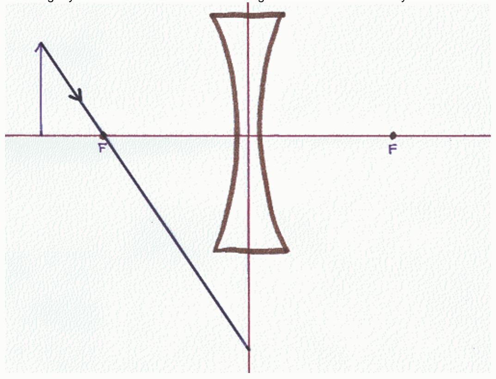

Principle Ray I. The easy one. Just as in the case of the converging lens, this ray goes straight through the center of the lens (through the point of intersection of the plane of the lens and the principle axis of the lens) with no change in direction of the ray.

Principle Ray II. Starting on the object side of the lens, ray II heads toward the plane of the lens along a line that is parallel to the principle axis of the lens. At the plane of the lens it abruptly adopts a path that takes it directly away from the focal point that is on the same side of the lens as the object. If you trace that ray straight back, the trace-back line passes through said focal point.

Principle Ray III. Starting from the head of the arrow that the object is, ray III travels directly toward the focal point on the other side of the lens. But, at the plane of the lens, the ray abruptly adopts a path that is parallel to the principle axis of the lens, and away from the object.

Tip: In every case, a principal ray travels from the head of the object to the plane of the lens. It passes through the plane of the lens, and continues traveling into the space on the other side of the plane of the lens (the side opposite that on which the object resides). In depicting principal rays, one must include at least one arrowhead (pointing toward the plane of the lens, on the ray segment that extends from the head of the object to the plane of the lens; and; at least one arrowhead (pointing away from the plane of the lens) on the ray segment on the other side of the lens (the side opposite that on which the object resides).

## Question 7

## 9 of 9 points

A person is tasked with creating a ray diagram to determine the characteristics of the image, of an object, formed by a concave lens. The person has correctly drawn the principal axis of the lens, the plane of the lens, the object, a lens icon to specify the kind of lens, and correctly drawn and labeled the focal points. Then the person draws the incoming ray shown. Which one of the following statements about that ray is most correct?

Selected Answer: ✓ That ray is not a principal ray.

Correct Answer: ✓ That ray is not a principal ray.

Feedback: Way to go.

The lens depicted in the diagram is a concave lens, a diverging lens.
