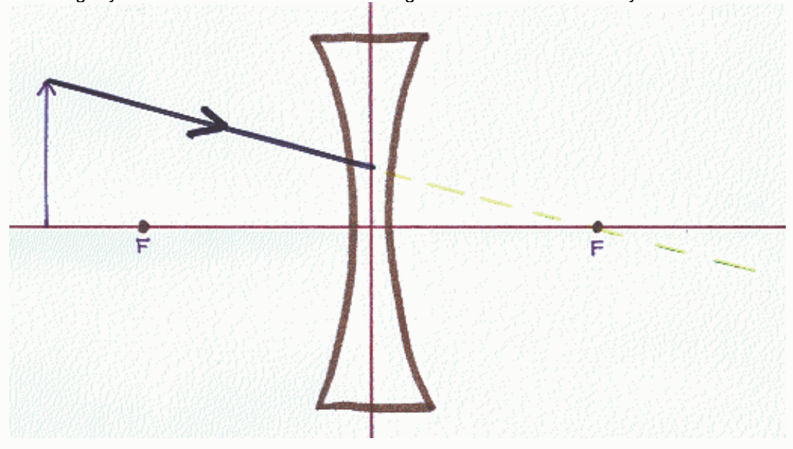

The given ray would be a principal ray for a converging lens, but, such a ray is diverging (from the principle axis of the lens) as it approaches the lens and the diverging lens will cause it to diverge even more. At the plane of the lens, the ray abruptly adopts a new path that makes a larger angle with the principle axis of the lens. We have no diagrammatic means of establishing the new path, that is, we don't know exactly where the light goes from there (from the point at which it "hits" the plane of the lens), hence, the ray in question is not a principle ray.

Note: The fact that the ray misses the "lens" does not rule it out as a principle ray. For one thing, the lens depicted in a principal ray diagram is just an icon, telling the reader what kind of lens is under investigation. It is not a scale size representation of the lens itself. Secondly, it doesn't matter whether the principle ray goes through the lens or not (although it must pass through the plane of the lens). The image formed by the rays that do pass through the lens will be in the same location that the principle rays predict, whether or not the diameter of the lens is great enough for the principle rays to actually contribute to the image.

## Question 8

## 0 of 9 points

A person is tasked with creating a ray diagram to determine the characteristics of the image of an object formed by a concave lens. The person has correctly drawn the principal axis of the lens, the plane of the lens, the object, a lens icon to specify the kind of lens, and correctly drawn and labeled the focal points. Then the person draws the incoming ray shown. Which one of the following statements about that ray is most correct?

## Selected Answer:

✗ That ray is not a principal ray.

## Correct Answer:

√ For purposes of determining the location of the image, the ray is to be drawn as if it continues as shown here:
