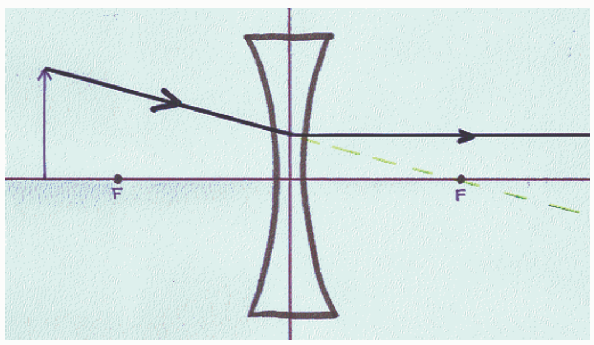
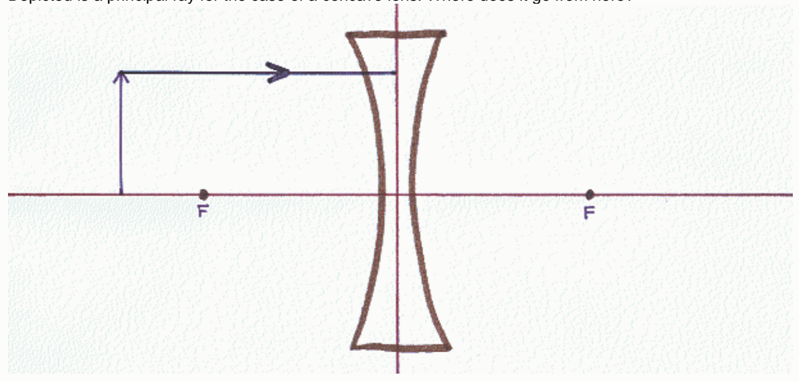

Feedback: In the case of a diverging lens, one of the principal rays is a ray that leaves the object and travels directly toward the focal point on the other side of the lens. At the plane of the lens, this ray abruptly changes its direction of travel to one which is parallel to the principal axis of the lens.

## Question 9

0 of 9 points

Depicted is a principal ray for the case of a concave lens. Where does it go from here?

Selected

Answer:
