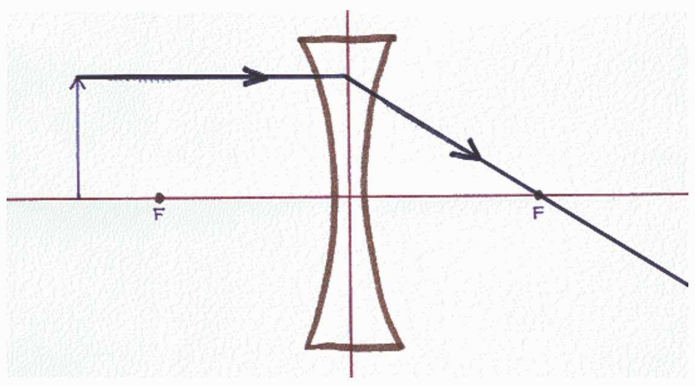
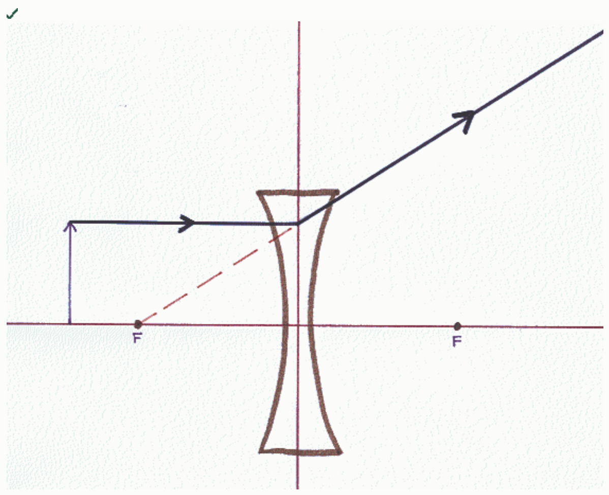

Correct Answer:

Feedback: In the case of a diverging lens, there is a ray that approaches the plane of the lens along a line that is parallel to the principal axis of the lens. At the plane of the lens, that ray jumps onto a path, which, if traced back through the lens, can be seen to be on a line that passes through the focal point on the same side of the lens as the object.
