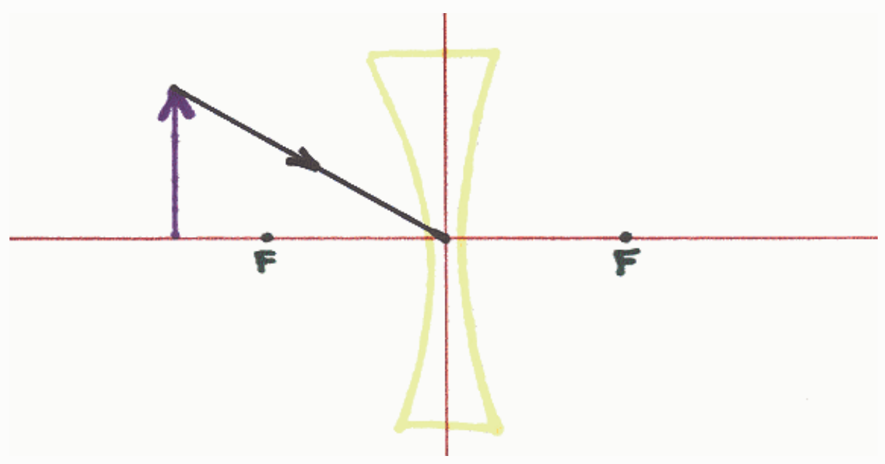
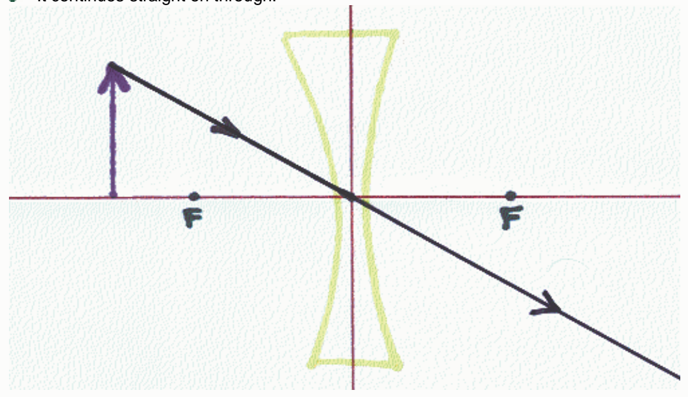

Selected Answer: ✗ It is not a principal ray.

Correct Answer: ✓ It continues straight on through.

Feedback: This is the easy principal ray. It is the only principal ray that is the same for both a converging lens and a diverging lens. It is the principal ray that leaves the object and heads straight toward the center of the lens, that is, straight toward the point at which the plane of the lens and the principal axis of the lens intersect. That principal ray keeps on going straight through the lens.
