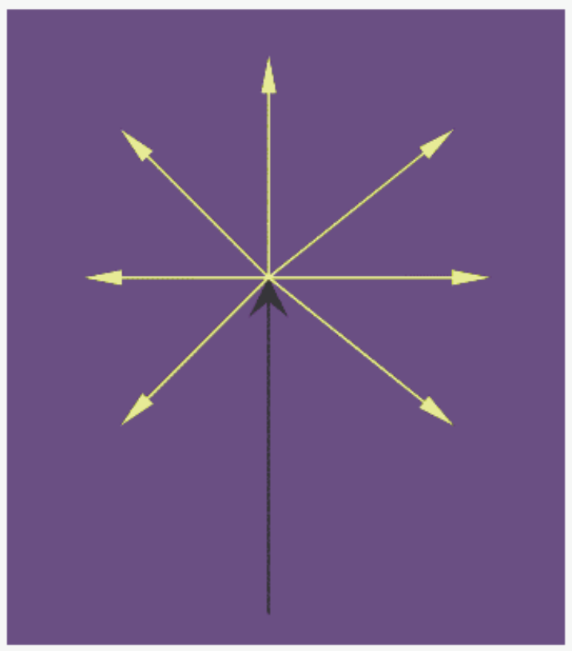

This is a geometric effect, more a property of space than of light. Consider two people starting, as close as possible, from the same point in the middle of a flat level field. Let each walk away from the starting point along a different straight line. Even if the angle between the two lines is small, the farther the people walk away from their common starting point, the farther they are from each other. We say that the lines the two people are walking along diverge from each other, just as light rays from one and the same point on an object diverge from each other.
