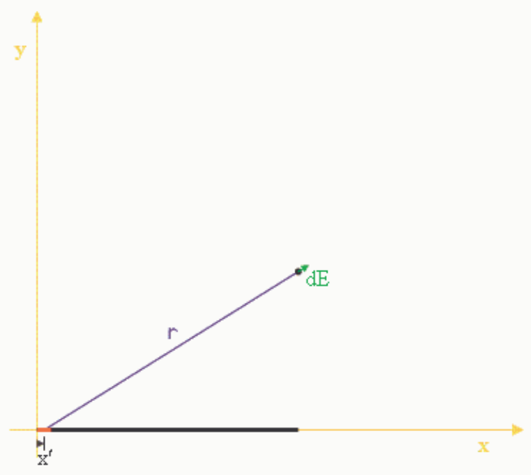

## Question 4

## 0 of 20 points

In calculating the electric field, at some point P in the x-y plane of a Cartesian coordinate system, due to a linear charge distribution in the x-y plane, each contribution to the electric field at point P, from each infinitesimal element of the charge distribution, is a vector.

Hence, to find the total electric field $\vec{E}$, one must do a vector sum of an infinite number of infinitesimal vectors $d\vec{E}$. How does one deal with such an enormous vector addition problem?

Selected Answer: ✗ The premise of the question is wrong. The electric field is a scalar, not a vector.

Correct Answer: ✓ None of the other answers is correct.

Feedback: Nice job.
What one does is to find the x-component of the electric field at point P due to an infinitesimal element of the linear charge distribution and sum up all such x-components to get the total x-component. A second, similar procedure yields the total y-component of the electric field at point P. The two components of $\vec{E}$ can be added like vectors to yield the total electric field.

## Question 5

## 0 of 20 points
