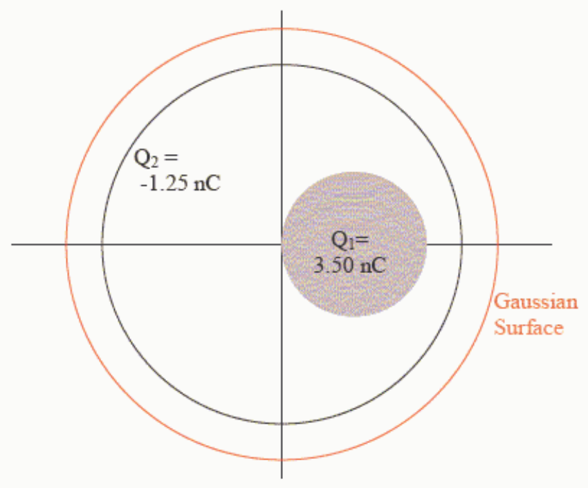

First off, please recall that a nC is $1 \times 10^{-9}\ \text{C}$ (exactly, where the C stands for coulombs).

Now take a look at the two Gauss's-Law-related equations on your formula sheet. The defining equation for electric flux:

$$\Phi_E = \oint \vec{E} \cdot d\vec{A}$$

and Gauss's law itself:

$$\oint \vec{E} \cdot d\vec{A} = \frac{Q_{\text{IN}}}{\epsilon_o}$$

These two equations can be combined so that Gauss’s law appears as:

$$\Phi_E = \frac{Q_{\text{IN}}}{\epsilon_o}$$

This is a cause and effect equation written in reverse. The cause is on the right and the effect is on the left. Charge within an imaginary closed surface causes electric flux through that surface.

This cause and effect equation known as Gauss's Law gives us a way to calculate the flux through a closed surface in a way that is much easier than actually doing the integral; namely; add up the charge inside the closed surface and divide that sum by the constant $\epsilon_o$.

In the case at hand, both charged objects are completely enclosed by the Gaussian surface in question (the imaginary surface through which we are supposed to determine the flux). Thus:

$$Q_{\text{IN}} = Q_1 + Q_2$$
