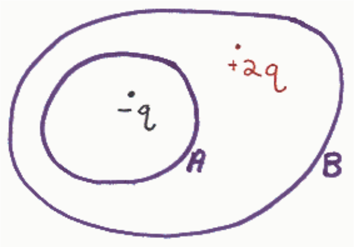
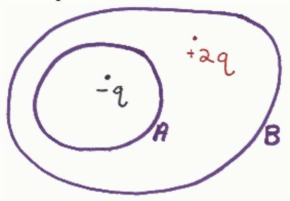

## Review Assessment: q32

Name: q32

Status : Completed

Score: 40 out of 100 points

## Instructions:

## Question 1

## 20 of 20 points

In the diagram below, the closed curves A and B represent closed surfaces. What is the total flux through the closed surface A?

Selected Answer: ✓
$$-\frac{q}{\varepsilon_o}$$

Correct Answer: ✓
$$-\frac{q}{\varepsilon_o}$$

Feedback: Nice work.

In accord with Gauss's Law, the net outward flux through a closed surface is equal to one-over-epsilon-zero times the charge enclosed by that surface.

## Question 2

## 0 of 20 points

In the diagram below the closed surfaces A and B appear as closed curves. Find the flux through closed surface B.

