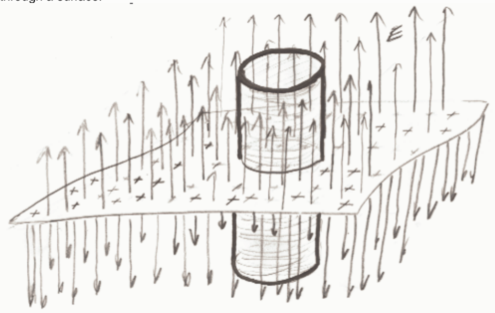

How can one tell that the electric flux through the walls of the can is zero? (If you remove the top of a can and the bottom of the can, that which is left, a piece that looks like a short length of pipe, is what we are calling the "walls" of the can.)

Selected Answer: ✗ At any point on the walls of the can, due to symmetry, the electric field through one side of the can will be equal but opposite to the electric field through the other side of the can, thus the two contributions to the flux cancel each other out, yield a total flux of zero.

Correct Answer: ✓ The electric field is parallel to the surface of the walls of the can, hence no electric field lines are poking through the walls of the can.

Feedback: Keep in mind that the "can" is an imaginary surface. No electric field lines "poking through" the surface means no flux. This way of looking at it shows a strong conceptual understanding of the outward flux through a surface.

One can also look at it more mathematically. The flux is

$$\oint \vec{E} \cdot d\vec{A}$$

Recalling that the direction associated with any area element $d\vec{A}$ of the wall of the can is perpendicular to the wall of the can. From the diagram above, one can deduce that any such vector is perpendicular to the electric field. Hence the dot product $\vec{E} \cdot d\vec{A}$ appearing in the integral above for the flux, is zero for every area element $d\vec{A}$. Thus, the integral itself has to be zero.

## Question 5

## 20 of 20 points

Which of the following would be a good choice of a Gaussian surface to use to find an expression for the electric field due to an infinite line of positive charge with a uniform linear charge density.

Selected Answer: ✓ A can whose axis of symmetry lies on the line of charge.

Correct Answer: ✓ A can whose axis of symmetry lies on the line of charge.

Feedback: Well done.

Note that the axis of symmetry of a can is a line passing through the center of both the top and bottom of the can. Here is an end view of the line of charge. It is a bit hard to imagine looking at the actual line of charge from this point of view since the line of charge extends to infinity in both directions, but, we picture it from an end view nonetheless, and recognize that, from that point of view, the line of charge, extending both directly toward us and directly away from us, looks like a dot.
